# Miudezas

<p align="center">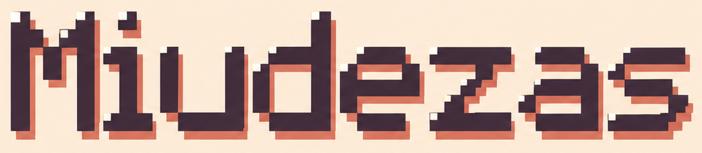</p>

**Dez jogos de bairro em uma janelinha.** Um balde quase cheio, uma mariposa no fio de cima, um ovo e um pão que douram em tempos diferentes. Em Miudezas, cada uma dessas cenas vira uma partida que se aprende olhando e se joga com poucas teclas ou um gesto.

<p align="center"></p>

| Coleção | Desafios | Tela de jogo | Plataforma |
|---|---|---|---|
| 10 minigames | 30 fases autorais + modos adicionais | Canvas de 96 × 96 pixels lógicos | Navegador de computador ou celular |

**Autor:** Luigi Scofano de Araujo · [Jogar no GitHub Pages](https://luigiscofano.github.io/Miudezas/) · [Licença MIT](LICENSE)

[Começar](#executar) · [Modos e telas](#modos-e-telas) · [Capturas reais](#telas-reais-da-versão-publicada) · [Identidade e artes](#identidade-visual) · [Os dez jogos](#jogos-e-level-design) · [Geração de fases](#geração-e-validação-de-fases) · [Arquitetura](#arquitetura) · [Dados e backup](#dados-e-som) · [Qualidade](#manutenção-e-testes) · [Publicação](#publicação-no-github-pages) · [Guias](#mapa-da-documentação)

---

## Estado atual em uma leitura

- **10 jogos e 30 fases autorais:** Sossegado, Animado e Puxado continuam disponíveis.
- **6 modos Sem Parar:** recordes pessoais persistentes, sem cronômetro final.
- **3 modos Caminho Novo:** fases reproduzíveis, solução validada e reinício na mesma semente.
- **Novidades consolidadas:** Maré com dez famílias e faixas avançadas, Gude com terrenos variados e níveis recalibrados, Rastro com percursos abertos e irregulares, Pipa com aves em V e colisão por pixels, lagartixa com três erros em todos os níveis.
- **Dados locais:** preferência de som, Volta no Bairro e recordes exportáveis. Não há conta, sincronização, ranking online ou sistema de medalhas implementado.

> Este README descreve a implementação atual. Imagens de marca são artes; cada ficha conserva o ícone e a miniatura armazenada e inclui uma **cena atual renderizada pelo próprio motor do jogo**, sem cursor. Essas cenas mostram o tabuleiro do nível Puxado. A seção de telas reais apresenta, separadamente, capturas completas da interface publicada. [Origem e reprodução das imagens](docs/imagens/jogos/README.md).

---

## Executar

A pasta `dist/` contém o próprio código-fonte executável. Basta servi-la por HTTP. A aplicação usa módulos JavaScript nativos, imagens e uma fonte local. A execução dispensa instalação de pacotes, compilação, banco de dados e chaves de API.

1. Baixe e extraia o repositório ou clone-o com Git.
2. Na raiz do projeto, execute um dos comandos abaixo com Python 3.
3. Abra **http://localhost:8000**. Para encerrar o servidor, pressione Ctrl+C no terminal.

```sh
python3 -m http.server 8000 --bind 127.0.0.1 --directory dist
```

No Windows com o inicializador Python:

```powershell
py -m http.server 8000 --bind 127.0.0.1 --directory dist
```

Para experimentar no celular, conecte os dois aparelhos à mesma rede local, execute o servidor com `--bind 0.0.0.0` e abra no celular o endereço IP local do computador na porta 8000. Para hospedar uma cópia, use o conteúdo de `dist/` como raiz do servidor estático. O endereço oficial no GitHub Pages é público e pode ser aberto em outros computadores ou celulares. A cópia local roda diretamente.

---

## Modos e telas

<details>
<summary>Expandir modos e telas</summary>

| Tela | O que se faz nela |
|---|---|
| Início | Escolher entre uma partida avulsa e a sequência. A barra oferece som, engrenagem de configurações e abertura da janela no desktop. |
| Galeria | Percorrer duas páginas com até seis miniaturas cada. A ordem segue o percurso do bairro. |
| Roteiro | Ver as dez paradas. Com progresso salvo, escolher entre retomar e iniciar uma nova volta. |
| Seleção de nível | Escolher **Sossegado**, **Animado** ou **Puxado**, além do modo adicional nos jogos elegíveis. As fases autorais permanecem disponíveis. |
| Próxima parada | Ler o objetivo e os comandos antes de iniciar o relógio do jogo. |
| Partida | Ver a cena, a meta ou o tempo no indicador e os botões correspondentes àquela mecânica. |
| Pausa | Consultar regras, continuar, **Voltar às fases** ou sair ao menu. Voltar às fases preserva o jogo selecionado e os dados salvos, sem registrar uma derrota artificial. Perder o foco ou ocultar a aba também pausa a partida. |
| Resultado | No avulso, repetir ou voltar à galeria. Na volta, repetir a parada ou avançar mesmo depois de uma derrota. |
| Resumo | Após a 10ª parada, ver os desafios vencidos e as dez miniaturas com seus resultados. |

### Telas reais da versão publicada

Capturas feitas no [GitHub Pages](https://luigiscofano.github.io/Miudezas/), sem cursor, em 18/11/2026. As seis imagens abaixo mostram a **janela completa da aplicação**, agora com a engrenagem de configurações visível, incluindo cabeçalho, conteúdo, controles e rodapé. Apenas a margem vazia externa do navegador foi recortada; nenhuma parte da interface foi redesenhada.

| Menu inicial | Seleção de jogos |
|:---:|:---:|
| 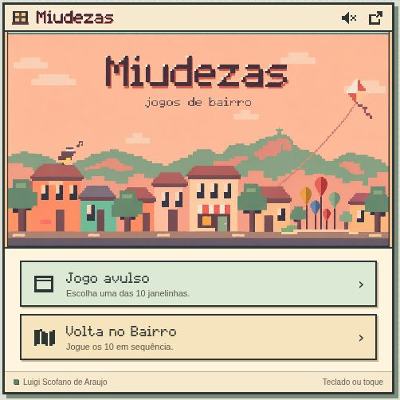 | 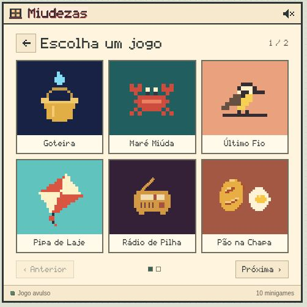 |

| Seleção de níveis | Partida em andamento |
|:---:|:---:|
| 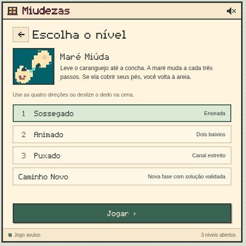 | 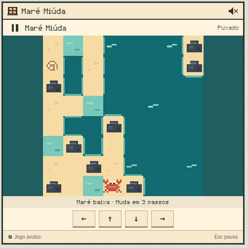 |

| Menu de pausa | Volta no Bairro |
|:---:|:---:|
| 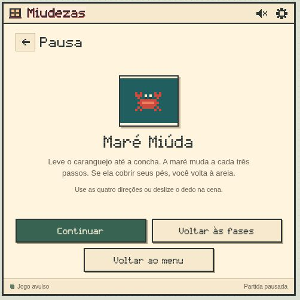 | 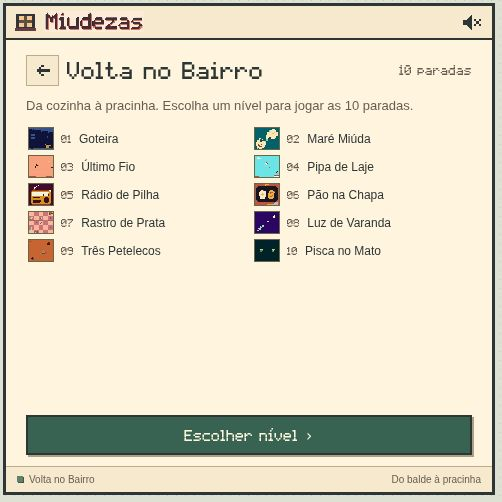 |

[Procedência e atualização das capturas](docs/imagens/telas/README.md). As fichas abaixo também apresentam o desenho atual do tabuleiro de **cada um dos dez jogos**, separado destas capturas de interface.

---

### Modos adicionais por jogo

São **seis jogos com Sem Parar e três com Caminho Novo**, além do Rádio com fases autorais. Os modos adicionais são partidas avulsas; a Volta no Bairro continua nas três dificuldades autorais. **Sem Parar** não tem meta final nem cronômetro de encerramento: superar o recorde não encerra a partida. **Caminho Novo** gera uma fase completa; repetir mantém a semente e gerar outra cria um percurso novo.

| Jogo | Modo adicional | Métrica ou razão |
|---|---|---|
| Goteira | Sem Parar | Gotas recolhidas até alagar o chão. |
| Maré Miúda | Caminho Novo | Percurso validado considerando passos, maré e última areia segura. |
| Último Fio | Sem Parar | Mariposas recolhidas até uma rajada atingir o fio ocupado. |
| Pipa de Laje | Sem Parar | Obstáculos superados até colidir. |
| Rádio de Pilha | Clássico | História finita em três transmissões; repetição arbitrária não melhora a proposta. |
| Pão na Chapa | Sem Parar | Alimentos corretos até o terceiro erro. |
| Rastro de Prata | Caminho Novo | Trilha sem cruzar o próprio rastro, com três folhas antes do vaso. |
| Luz de Varanda | Sem Parar | Mosquitos capturados pela lagartixa; o terceiro bote errado encerra, sem prazo final. |
| Três Petelecos | Caminho Novo | Percurso validado com a física e os controles de lançamento reais. |
| Pisca no Mato | Sem Parar | Maior sequência concluída; errar encerra. |

**Uma volta de exemplo.** Escolha Animado, jogue Goteira e avance. O próximo cartão é Maré Miúda no mesmo nível. Fechar o navegador nesse cartão permite retomar na segunda parada. Se sair no meio da partida, ela recomeça naquela parada. O avanço registra um resultado por jogo.

### Controles diretos e alternativa acessível

O gesto principal atua sobre o objeto do jogo: em **Rastro de Prata**, comece no caracol e trace pelas casas vizinhas; em **Três Petelecos**, comece sobre a bolinha, puxe e solte para lançar. Começar fora desses objetos não inicia um arrasto válido. Interrupções como `pointercancel` ou perda de foco cancelam o lançamento parcial: não equivalem a soltar voluntariamente a bolinha.

Teclado e botões direcionais continuam sendo alternativas ao arrasto; não é necessário dominar o gesto para jogar. A restrição de gestos nativos (`touch-action`) fica limitada ao tabuleiro interativo, sem bloquear a rolagem da página inteira. Confira também foco visível, leitura das instruções e funcionamento em telas estreitas.

**Comandos gerais.** Setas e WASD têm a mesma função nas partidas. Nos menus, use setas para navegar e Enter para selecionar. Esc volta ou pausa. No celular, os botões sob a cena complementam os gestos próprios de cada jogo. O computador solicita uma janela de 492 × 492 quando a área tem ao menos 700 px de largura e o dispositivo aponta com precisão. Ao abrir a janela separada, a página original suspende música e efeitos sem alterar as preferências de som ou volume. Ela permanece silenciosa enquanto essa janela estiver aberta; após fechá-la, um novo toque ou tecla na página original pode retomar o áudio. Se o navegador bloquear a abertura, o jogo e o áudio seguem na página.

---


</details>

## Identidade visual

<details>
<summary>Expandir identidade visual</summary>

### Memórias, Tijuca e cotidiano brasileiro

Meus dois pais viveram a vida toda na Tijuca. Busquei no bairro e nas minhas memórias de família a inspiração para a identidade visual de **Miudezas**. Os temas do cotidiano brasileiro dão forma a um jogo que quis tornar confortável e aconchegante, como essas lembranças.

Eu sempre via a obra **Balões ou Ritual do Vento**, do escultor **Gabriel Fonseca**, ao ir para a casa da minha avó na Tijuca. Suas formas e cores são reinterpretadas em pixel art na capa, junto das casas, dos morros, da pipa e do bem-te-vi. A arte e a música suave procuram transmitir esse acolhimento, criando um lugar para desacelerar, explorar e brincar.

— Luigi Scofano de Araujo

**Referência artística:** [catálogo de Gabriel Fonseca](https://gabrielsculptor.com/about/), mantido pela família do artista. A obra é situada na Lagoa Rodrigo de Freitas pela fonte; a Tijuca se refere à memória familiar e ao destino das visitas, não à localização do monumento. A paisagem da capa é uma composição afetiva, não uma reprodução geográfica do bairro.

O nome **Miudezas** reúne acontecimentos pequenos o bastante para caber numa janela. A capa os situa no mesmo bairro. O bem-te-vi pousa no telhado com uma nota musical; a linha da pipa parte de trás de uma casa. As fachadas, árvores apoiadas no chão e montanhas evocam a Tijuca. Um Cristo discreto e uma interpretação do Ritual do Vento completam a paisagem. Uma janela verde com a letra M funciona como ícone do conjunto, inclusive na aba do navegador.

| Elemento | Aplicação e critério |
|---|---|
| Moldura | Contorno escuro, barra clara e sombra deslocada lembram uma janela de computador. A moldura separa a interface persistente das cores próprias de cada cena. |
| Tipografia | **Miudezas Pixel**, fonte local com acentos, identifica títulos, níveis e comandos. Verdana, Arial e a fonte sem serifa do sistema sustentam regras e textos corridos. |
| Escala | A cena ativa é desenhada em 96 × 96 e ampliada com pixels aparentes. As dez miniaturas ativas têm 128 × 120; a capa mede 1672 × 941 e o ícone verde mede 390 × 390. |
| Silhueta | Asa curta e peito amarelo identificam o pássaro. Um retângulo de água sob a rachadura avisa onde a gota vai cair. Cada detalhe precisa continuar legível no tamanho da janela. |
| Pequenas irregularidades | A alça do balde cai de lado, a antena do rádio dobra e as fachadas variam um pixel. A irregularidade pertence ao objeto. As áreas de toque e as regras continuam previsíveis. |
| Sinais de jogo | O fio treme antes da rajada, o pão muda de cor e solta vapor, a luz do rádio indica sintonia. Sons curtos confirmam ações, enquanto o indicador escrito conserva a informação principal. |

### Marca e organização das artes

 

O logotipo escrito identifica o conjunto; o **M na janela verde** é o favicon; a **janela de quatro vidraças** permanece na barra. São arquivos distintos e não substituem os sprites das partidas.

- [Capa](dist/artes/capas/README.md): composição completa, sem recortes ou título sobreposto.
- [Marca](dist/artes/marca/README.md): logotipo, favicon e janela original.
- [Ícones](dist/arte/icones/README.md): os dez símbolos usados na seleção e na pausa.
- [Miniaturas, fonte e legado](dist/arte/README.md): inventário separado de material ativo e histórico.
- [Arte em código](docs/design/README.md): animais, alimentos, objetos, cenários e ícones inline efetivamente desenhados pelos módulos.

Os caminhos existentes foram mantidos para não quebrar o jogo. A organização é feita por índices e inventário, sem duplicar imagens. O [histórico visual](docs/evolucao-visual.md) preserva os detalhes das decisões anteriores.

### Paleta da interface

| Uso | Cor | Onde aparece |
|---|---|---|
| Tinta |  `#2E3535` | Texto principal, contorno da janela e botões |
| Papel |  `#FFF5DF` | Fundo das telas de leitura |
| Creme |  `#F7E9CD` | Barra superior, rodapé e controles secundários |
| Borda |  `#B9AD8E` | Separação de grupos e opções |
| Verde |  `#386251` | Ação principal e nível selecionado |
| Texto secundário |  `#655D50` | Instruções e detalhes |
| Ouro |  `#F4BF64` | Resposta ao pressionar o controle |
| Área de trabalho |  `#DCE1D4` | Fundo pontilhado em volta da janela |

As cores de cada palco aparecem nas fichas abaixo. São as cores de enquadramento definidas pelo catálogo. Os sprites e fundos internos têm paletas próprias nas funções de desenho. [Folha de estilos](dist/style.css) · [Catálogo](dist/catalogo.js) · [Acervo visual](dist/arte/README.md)

### Cores recorrentes nos desenhos dos jogos

Além das oito cores estruturais da interface, estas oito amostras mostram tons reutilizados nos cenários, alimentos e utensílios. A seleção prioriza cores com **três ou mais ocorrências literais nos módulos ativos de desenho**, agrupadas pelo uso visual, sem listar cada variação de sombra. Isso indica recorrência no código, não a porcentagem de pixels na tela: uma cor declarada uma única vez pode preencher um fundo inteiro. Cores dos módulos legados foram excluídas.

| Tom | Amostra e código | Uso real e fonte |
|---|---|---|
| Azul profundo |  `#263653` | Traços repetidos do cenário de Goteira. [quintal.js](dist/quintal.js) |
| Pêssego |  `#F8BE92` | Blocos das nuvens no céu de Último Fio. [quintal.js](dist/quintal.js) |
| Terracota |  `#D98A71` | Volumes de construções no cenário de Último Fio. [quintal.js](dist/quintal.js) |
| Cinza metálico |  `#B9BDC8` | Partes metálicas da espátula e da pinça em Pão na Chapa. [esquina.js](dist/esquina.js) |
| Castanho da crosta |  `#A9512F` | Crosta e sombras do pão em diferentes pontos de preparo. [esquina.js](dist/esquina.js) |
| Creme dos alimentos |  `#FFF2D7` | Clara do ovo, detalhe do pão e base dos seletores de utensílios. [esquina.js](dist/esquina.js) |
| Violeta da parede |  `#3A2A65` | Linhas de relevo da parede em Luz de Varanda. [varanda.js](dist/varanda.js) |
| Violeta claro |  `#4D3976` | Pequenas marcas na parede em Luz de Varanda. [varanda.js](dist/varanda.js) |

As cores de enquadramento de cada jogo continuam nas respectivas fichas. Esta seleção complementa a paleta da interface; não substitui as paletas específicas dos sprites.

---


</details>

## Elementos visuais dentro dos jogos

<details>
<summary>Expandir elementos visuais dentro dos jogos</summary>

O [acervo organizado por jogo](docs/elementos-visuais/README.md) reúne **47 famílias de elementos reais dos dez jogos**: pote, três folhas, caracol, siri, concha, bolinha e buraco, lagartixa, mosquito, vagalumes, bem-te-vi, mariposa, alimentos, utensílios, obstáculos e cenários. O pote inclui a versão mais recente.

Não são os ícones da seleção: os SVGs vêm das próprias chamadas de desenho das partidas. As pranchas abaixo têm fundo neutro e escala ajustada por quadro para consulta. Preservam as cores e os pixels do motor, mas **não são screenshots nem indicam a escala relativa dos objetos entre quadros**. Cada grupo contém um estado representativo, não todos os quadros animados.

<details>
<summary><strong>Goteira</strong> · 5 famílias visuais</summary>

Teto e rachaduras; Janela e marcas da parede; Piso, ralo e água no chão; Gotas e respingos; Balde, alça e conteúdo.

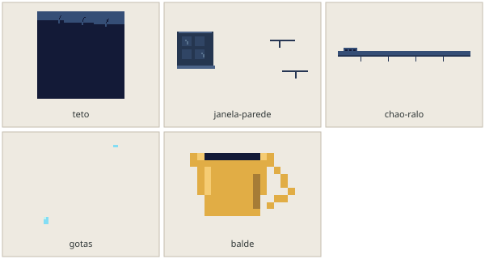

[Abrir arquivos e explicações](docs/elementos-visuais/goteira/README.md).

</details>

<details>
<summary><strong>Maré Miúda</strong> · 4 famílias visuais</summary>

Mar, areia, espuma, ondulações e travessias; Pedras e sombras; Concha de destino; Siri / caranguejo.

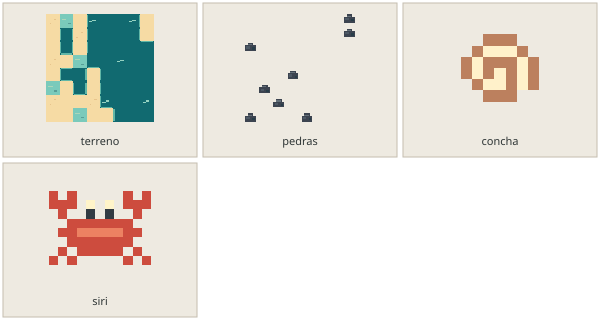

[Abrir arquivos e explicações](docs/elementos-visuais/mare/README.md).

</details>

<details>
<summary><strong>Último Fio</strong> · 5 famílias visuais</summary>

Céu e nuvens; Casas, telhados e chaminé; Fios e sinal de rajada; Mariposa; Bem-te-vi.

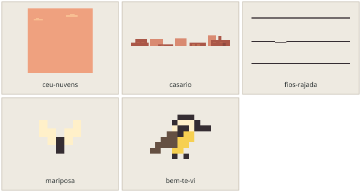

[Abrir arquivos e explicações](docs/elementos-visuais/fio/README.md).

</details>

<details>
<summary><strong>Pipa de Laje</strong> · 6 famílias visuais</summary>

Céu e nuvens; Duas camadas de morros; Fachadas, janelas, portas e telhados; Postes e lajes; Bando de aves em V; Pipa, linha, rabiola e laços.

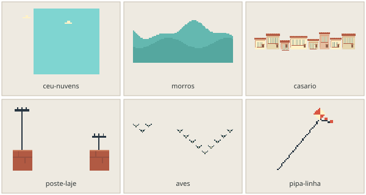

[Abrir arquivos e explicações](docs/elementos-visuais/pipa/README.md).

</details>

<details>
<summary><strong>Rádio de Pilha</strong> · 5 famílias visuais</summary>

Parede e bancada; Antena, caixa e acabamento; Escala, ponteiro e luz de sintonia; Grade do alto-falante; Botão e marcadores das estações.

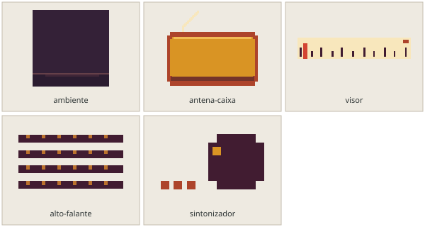

[Abrir arquivos e explicações](docs/elementos-visuais/radio/README.md).

</details>

<details>
<summary><strong>Pão na Chapa</strong> · 5 famílias visuais</summary>

Chapa, alça, bordas e fundo; Ovo: clara, gema e brilho; Pão francês e cortes da casca; Vapor dos alimentos; Espátula, pinça e seleção.

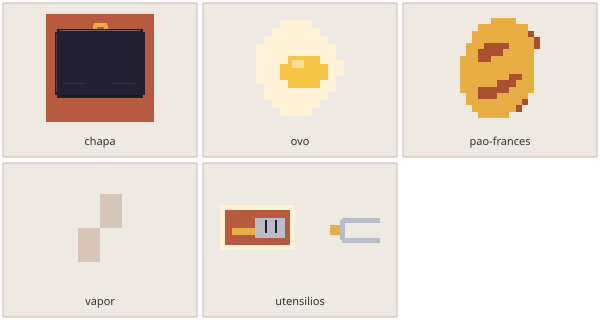

[Abrir arquivos e explicações](docs/elementos-visuais/pao/README.md).

</details>

<details>
<summary><strong>Rastro de Prata</strong> · 6 famílias visuais</summary>

Ladrilhos e acabamento; Três folhas com desenhos diferentes; Pedras; Pote de destino; Rastro construído; Caracol e concha.

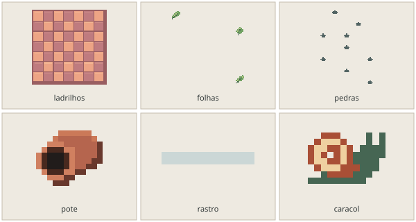

[Abrir arquivos e explicações](docs/elementos-visuais/rastro/README.md).

</details>

<details>
<summary><strong>Luz de Varanda</strong> · 4 famílias visuais</summary>

Parede, relevo e rodapé; Lâmpada, fio e sinais de luz; Mosquito e asas; Lagartixa: corpo, membros, cauda e olhos.

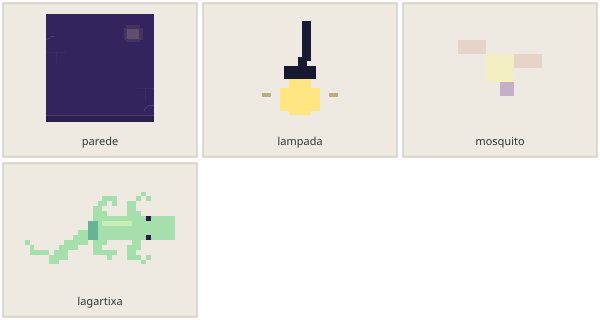

[Abrir arquivos e explicações](docs/elementos-visuais/luz/README.md).

</details>

<details>
<summary><strong>Três Petelecos</strong> · 5 famílias visuais</summary>

Terra batida, grãos e vegetação; Buraco de destino; Pedras e sombras; Mira e indicação de alcance; Bolinha de gude, brilho e sombra.

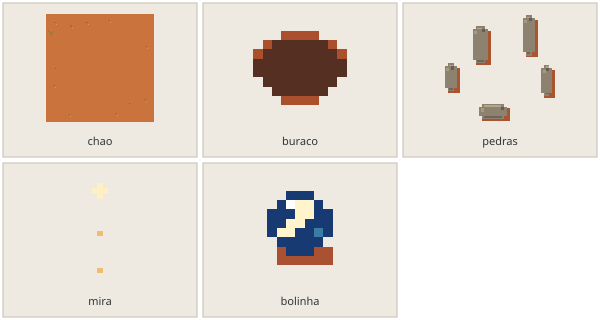

[Abrir arquivos e explicações](docs/elementos-visuais/gude/README.md).

</details>

<details>
<summary><strong>Pisca no Mato</strong> · 2 famílias visuais</summary>

Fundo noturno e vegetação; Vagalumes, asas, abdômen e sinais de luz.

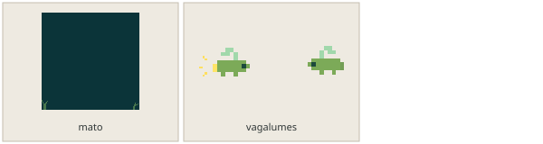

[Abrir arquivos e explicações](docs/elementos-visuais/pisca/README.md).

</details>

[Procedência, limites e reprodução do acervo](docs/elementos-visuais/README.md). Nenhuma arte ou regra do jogo foi modificada para produzir esta documentação.

---


</details>

## Jogos e level design

<details>
<summary>Expandir jogos e level design</summary>

Cada ficha mostra o ícone atual, a miniatura já armazenada e uma cena atual do tabuleiro, além do objetivo, dos comandos e da diferença implementada entre os três níveis. Nos jogos de tempo, a dificuldade altera a margem de reação. Nos de percurso, ela altera o mapa. Nos de memória, amplia o que o jogador precisa reter.

### 01 · Goteira

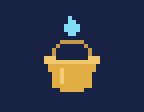 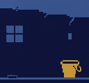

**Cena atual · Puxado**

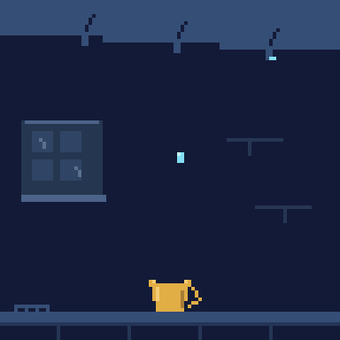

Pegue as gotas por um minuto. O balde comporta quatro. Encoste no ralo à esquerda para esvaziá-lo. **Comandos.** ← e → movem o balde. No celular, segure um lado da cena.

| Sossegado | Animado | Puxado |
|---|---|---|
| **Chuvisco** · Intervalo de 1,85 s, queda a 27 px/s | **Chuva firme** · 1,52 s e 34 px/s | **Temporal** · 1,20 s e 40 px/s |

A gota espera 0,55 s na rachadura. O balde guarda quatro: a quinta transborda para o chão sem aumentar o conteúdo. Gotas não recolhidas também molham o piso, uma contagem por gota. Os limites são **12, 9 e 6 gotas no chão**, respectivamente; ao atingir o limite, aparece **“O chão alagou!”** e a partida termina. Ir ao ralo libera capacidade. Nas fases autorais, sobreviver aos 60 s e captar pelo menos uma gota conta como vitória. Em **Sem Parar**, o limite é 8 gotas no chão e não há encerramento por tempo.

Palco `#172244` · [Implementação de Goteira](dist/quintal.js)

---

### 02 · Maré Miúda

O caranguejo jogável usa a arte em pixel art: pinças simétricas, olhos definidos e destaque discreto na carapaça, dentro da célula original. A arte ocupa a mesma célula lógica usada pelas regras.


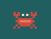 

**Cena atual · Puxado**

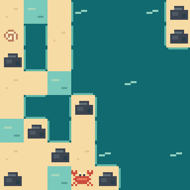

Leve o caranguejo até a concha. A maré muda a cada três passos. Se ela levar você, as duas primeiras vezes devolvem à areia; a terceira encerra a tentativa em qualquer modo. **Comandos.** Use as quatro direções ou deslize o dedo na cena.

| Sossegado | Animado | Puxado |
|---|---|---|
| **Enseada** · Mapa 8 × 8 com banco raso contínuo | **Dois baixios** · Mapa 8 × 8 com dois baixios separados | **Canal estreito** · Mapa 8 × 8 com passagens rasas estreitas |

Apenas um passo válido avança a maré. No terceiro passo, se a água subir sobre uma casa rasa, conta uma vez como levado pela maré. Nas duas primeiras ocorrências o caranguejo retorna à última casa firme; na terceira, perde com “A maré te levou!”. O HUD mostra “Maré levou 0/3”. O limite vale em Sossegado, Animado, Puxado e Caminho Novo. Reiniciar zera o contador e, no Caminho Novo, conserva a semente da fase. Circular na areia permite preparar uma travessia. O Puxado atual usa o mapa escolhido da semente **1428316038**, com o siri na última linha (coluna 4), quatro baixios indispensáveis e solução mínima de 21 comandos. Caminho Novo combina dez famílias; veja os critérios na [seção de geração](#geração-e-validação-de-fases).

Palco `#205E60` · [Implementação de Maré Miúda](dist/quintal.js)

---

### 03 · Último Fio

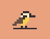 

**Cena atual · Puxado**

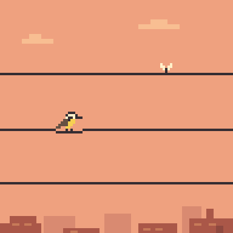

Pegue cinco mariposas. Quando um fio tremer, pule para outro antes da rajada. **Comandos.** ← e → dão pulinhos. ↑ e ↓ trocam de fio. No celular, deslize.

| Sossegado | Animado | Puxado |
|---|---|---|
| **Brisa** · Fio avisa com 1,65 s | **Ventania** · Aviso de 1,25 s | **Vendavau** · Aviso de 0,92 s |

Os três fios dividem a altura em linhas e cada uma tem dez posições. A mariposa indica o destino, mas o tremor muda a prioridade. Estar no fio ameaçado no fim do aviso encerra a rodada.

Em **Sem Parar**, as mariposas são repostas continuamente e cada captura soma um ponto; a rajada continua sendo a condição de derrota.

Palco `#E9A17E` · [Implementação de Último Fio](dist/quintal.js)

---

### 04 · Pipa de Laje

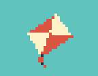 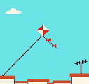

**Cena atual · Puxado**

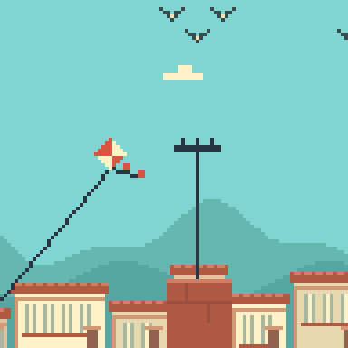

Chegue à última laje com a rabiola inteira. Passe entre os postes e os pássaros. **Comandos.** ↑ solta linha e ↓ recolhe. No celular, segure a parte de cima ou de baixo.

| Sossegado | Animado | Puxado |
|---|---|---|
| **Laje vizinha** · 4 obstáculos, cenário a 14 px/s | **Fim da rua** · 5 obstáculos, 17 px/s | **Outro quarteirão** · 6 obstáculos, 20 px/s |

Postes limitam a passagem por baixo e pássaros ocupam a parte alta. Casas estreitas, janelas altas, telhas e morros compõem o cenário carioca, sem colisão com elementos decorativos. A pipa responde gradualmente e o vento varia. Nas fases Sossegado, Animado e Puxado, aberturas altas e baixas se alternam, exigindo subir e descer. As margens diminuem de 8 para 7 e 6 pixels e a velocidade cresce; ficar numa única altura não resolve a fase. Uma colisão prende a rabiola. Em Sem Parar, os obstáculos continuam sendo repostos e a pontuação conta passagens até colidir. O bando em V tem uma ponta inferior e pares de aves nos dois lados; a colisão usa os pixels das aves, não um retângulo preenchendo o espaço entre elas.

Palco `#60C3BD` · [Implementação de Pipa de Laje](dist/quintal.js)

---

### 05 · Rádio de Pilha

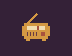 

**Cena atual · Puxado**

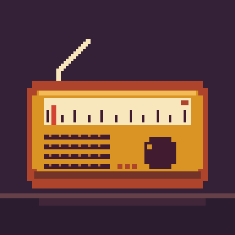

Encontre três estações antes que a pilha acabe. Quando a luz firmar, pare para ouvir. **Comandos.** ← e → ajustam o ponteiro. No celular, arraste pelo mostrador.

| Sossegado | Animado | Puxado |
|---|---|---|
| **Sinal forte** · 52 s de pilha, tolerância de 4,2% do dial | **Pouca pilha** · 44 s e 3,2% | **Sinal distante** · 36 s e 2,3% |

As estações ficam em 18%, 54% e 83% do mostrador. Pare por 0,58 s na faixa. Cada transmissão dura 2,2 s e suspende o gasto da bateria. As três, do canário desaparecido ao estúdio, formam uma pequena história.

Palco `#4F2A48` · [Implementação de Rádio de Pilha](dist/esquina.js)

---

### 06 · Pão na Chapa

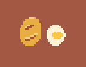 

**Cena atual · Puxado**

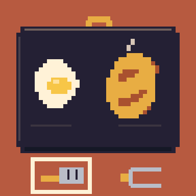

Use **espátula no ovo** e **pinça no pão**. Selecione o utensílio por clique/toque ou pelas teclas **1 e 2**, depois clique/toque no alimento. **← e →** continuam recolhendo o lado correspondente com o utensílio selecionado. Os botões mostram alimento e lado; os rótulos acessíveis também informam o ponto. Cores e fumaça indicam o preparo na cena, sem quadradinhos de estado adicionais.

| Ritmo | Meta | Preparo do pão / ovo | No ponto | Tostado (última chance) |
|---|---|---|---|---|
| Sossegado | 3 ovos + 3 pães | 4,60 / 4,95 s | 2,80 s | 1,20 s |
| Animado | 4 ovos + 4 pães | 3,50 / 3,85 s | 1,90 s | 0,90 s |
| Puxado | 5 ovos + 5 pães | 2,60 / 2,95 s | 1,30 s | 0,70 s |

Há sempre um ovo e um pão, com relógios e identidades próprios. O pão inicial já tem 1,2 s de preparo para escalonar as escolhas. Após duas reposições, os alimentos trocam de lado; o aviso **“Troca de lados!”** acompanha uma pausa de 0,75 s no cozimento e na coleta. O estado dos alimentos é conservado, sem movimento contínuo que atrapalhe a leitura.

- **Vitória:** complete as duas metas em até um minuto de chapa ativa. O último recolhimento encerra imediatamente; não é preciso esperar o relógio.
- **Derrota:** o terceiro erro ou o prazo esgotado sem ambas as metas encerra a fase; “Jogar de novo” inicia uma tentativa limpa (ou “Repetir parada” na Volta no Bairro).
- **Erro:** deixar queimar ou usar o utensílio errado. Um queimado conta uma única vez e é reposto após 0,85 s. A tentativa com utensílio errado também repõe aquele alimento, sem cobrar uma queima adicional.
- **Cru:** a coleta é ignorada com aviso, sem inventar uma terceira penalidade. **Tostado:** ainda pode ser servido antes de queimar.
- **Sem Parar:** sem metas nem prazo final, com uma pontuação por alimento correto e derrota no terceiro erro. A velocidade cresce gradualmente até 125% da inicial.
- **Progresso:** resultados anteriores e a Volta no Bairro permanecem compatíveis; os recordes adicionais são separados por jogo.


Palco `#A25843` · [Implementação de Pão na Chapa](dist/esquina.js)


---

### 07 · Rastro de Prata

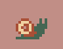 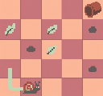

**Cena atual · Puxado**

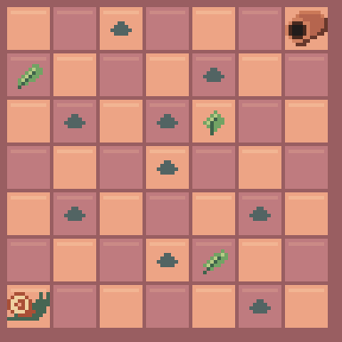

Pegue três folhas e entre no vaso. Seu rastro bloqueia o caminho. Volte pela última casa para desfazer o passo. **Comandos.** Use as quatro direções como alternativa ou inicie no caracol e trace o percurso pelas casas vizinhas com mouse ou toque.

| Sossegado | Animado | Puxado |
|---|---|---|
| **Quintal 5 × 5** · Tabuleiro de 5 × 5 | **Quintal 6 × 6** · Tabuleiro de 6 × 6 | **Quintal 7 × 7** · Tabuleiro de 7 × 7 |

O caminho ocupa as casas percorridas. Refazer o último passo desfaz também a coleta realizada naquela casa. Para entrar no vaso, recolha todas as três folhas no caminho atual. Caminho Novo usa o Puxado como referência e valida as restrições do rastro, não apenas a conectividade do tabuleiro. [Geração e testes](docs/jogos/esquina/README.md).

Palco `#C18E86` · [Implementação de Rastro de Prata](dist/esquina.js)


O destino usa o pote de barro: abertura circular, contorno regular e sombras escuras, sem a faixa clara atrás dele. A cena atual acima reproduz essa versão; fases, controles e progresso permanecem iguais.

---

### 08 · Luz de Varanda

 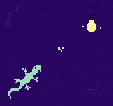

**Cena atual · Puxado**

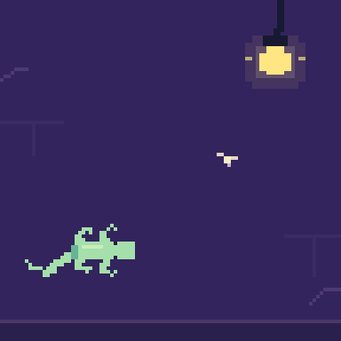

Espere a lagartixa apontar para um mosquito e dê o bote. Alcance a meta antes de a lâmpada apagar. **Comandos.** Aperte uma seta ou toque na cena para dar o bote.

| Sossegado | Animado | Puxado |
|---|---|---|
| **2 mosquitos** · 2 capturas em 25 s | **3 mosquitos** · 3 capturas em 24 s | **4 mosquitos** · 4 capturas em 23 s |

A cabeça da lagartixa varre um arco. O jogador decide o instante do bote. Em níveis altos, a mira gira mais depressa e o ângulo de acerto também fica menor. Em **Sem Parar**, não há prazo de encerramento: cada mosquito capturado soma um ponto e o terceiro bote errado encerra a partida. As fases autorais mantêm suas metas e tempos, mas também terminam em derrota no terceiro bote errado. O painel mostra os erros restantes em todos os modos. Um erro é contado uma única vez ao concluir um bote sem captura.

Palco `#30234B` · [Implementação de Luz de Varanda](dist/varanda.js)

---

### 09 · Três Petelecos

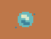 

**Cena atual · Puxado**

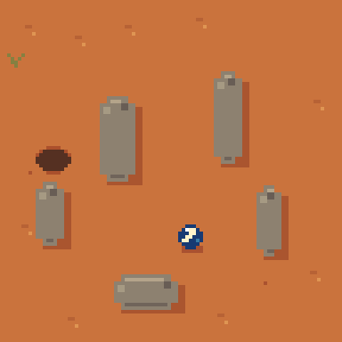

Acerte o buraco em até três petelecos. Quanto mais tempo segurar a direção, mais longe a bolinha vai. **Comandos.** Segure uma seta e solte. Com mouse ou toque, inicie na bolinha, puxe para trás e solte; cancelar o gesto não lança.

| Sossegado | Animado | Puxado |
|---|---|---|
| **Terra batida** · Três pedras, curva ampla e um tiro de reserva | **Entre pedras** · Quatro pedras, retorno em três tiros | **Caminho torto** · Cinco pedras, três tiros em percurso escalonado |

As fases autorais têm posições iniciais, alvos e obstáculos próprios. Sossegado tem solução em dois tiros e um de reserva; Animado e Puxado têm percursos certificados de três tiros. No Caminho Novo, variam origem, destino, quantidade e posição das pedras, trajeto e força. Há cotovelos, travessias, retornos e passagens escalonadas. As pedras e limites desviam a trajetória. A validação executa os lançamentos na física real do jogo, incluindo tolerância de entrada; não presume que um caminho desenhado seja jogável. [Critérios e limitações](docs/jogos/varanda/README.md).

Palco `#BE7749` · [Implementação de Três Petelecos](dist/varanda.js)


---

### 10 · Pisca no Mato

 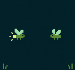

**Cena atual · Puxado**

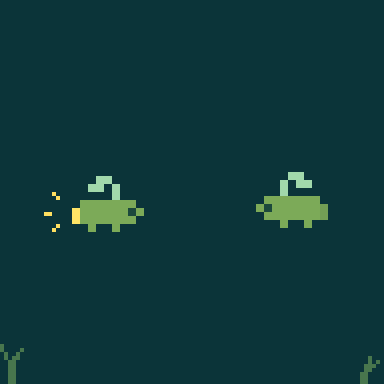

Observe os vaga-lumes e repita as piscadas na ordem. A cada acerto a sequência ganha uma luz. **Comandos.** ← acende o da esquerda e → o da direita. No celular, toque no vaga-lume.

| Sossegado | Animado | Puxado |
|---|---|---|
| **3 piscadas** · 3 piscadas, pulso de 0,525 s | **4 piscadas** · 4 piscadas, pulso de 0,470 s | **5 piscadas** · 5 piscadas, pulso de 0,415 s |

Uma piscada é acrescentada após cada sequência correta. O vaga-lume esquerdo soa a 392 Hz e o direito a 587 Hz. O jogador responde depois da demonstração. Trocar a ordem encerra a partida.

Em **Sem Parar**, a sequência continua crescendo e a pontuação é a maior sequência completamente respondida, não respostas parciais.

Palco `#1A393B` · [Implementação de Pisca no Mato](dist/varanda.js)

---


</details>

## Geração e validação de fases

<details>
<summary>Expandir geração e validação de fases</summary>

Os três geradores usam sementes, orçamento finito de tentativas e reservas validadas. Repetir conserva a fase; “Nova fase” troca a semente. As fases fixas não dependem do sorteio. A dificuldade é estimada por restrições verificáveis, não uma garantia subjetiva de dificuldade para toda pessoa.

### Maré Miúda: travessia e sincronização

| Família | Critérios principais |
|---|---|
| Original | 17–27 comandos, custo de maré ≥3, pelo menos dois baixios indispensáveis e pedras relevantes. |
| Enseadas irregulares | 23–27 comandos, custo de maré ≥5, três baixios indispensáveis; corredores quebrados e posições variadas. |
| Arquipélagos | 23–27 comandos, custo de maré ≥7, três baixios indispensáveis; ilhas, pontes e escolhas locais. |
| Muito difícil | 30–48 comandos, custo de maré 12–17, cinco travessias indispensáveis, áreas de escolha e praças secas. |
| Muitíssimo difícil | 38–60 comandos, custo de maré ≥18, seis travessias indispensáveis e os mesmos critérios espaciais. |
| Canais ramificados | Árvore irregular com bifurcações e becos; 30–60 comandos, custo de maré ≥8 e três baixios indispensáveis. |
| Anel de maré | Um ciclo independente com passagem rasa alternativa e travessias obrigatórias fora do anel. |
| Bacias gêmeas | Dois ciclos independentes e pelo menos dois baixios alternativos, mantendo os gargalos obrigatórios. |
| Estreito duplo | Árvore com duas casas rasas consecutivas, ambas indispensáveis: a entrada precisa coincidir com a janela da maré. |
| Anel e estreito | Combina um ciclo alternativo com o estreito duplo obrigatório. |

A busca considera **posição, fase da maré e última areia segura**. “Custo da maré” é a diferença entre soluções mínimas com e sem a mecânica; bloquear um baixio indispensável torna a concha inalcançável. A mistura atual reserva aproximadamente **10% para cada uma das dez famílias**: 50% de padrões anteriores e 50% dos cinco novos. Os cinco padrões de canais usam 30–60 comandos, custo de maré ≥8, três baixios indispensáveis e pedras que encurtariam a solução se removidas. A seleção usa a semente módulo dez, mantendo a referência 1428316038. Sementes antigas podem produzir outro mapa nesta versão; fases autorais e saves não mudam. `gerarMareLegada()` permite auditar a reprodução anterior. Limites de 48, 96, 64 ou 128 candidatos, conforme a família, evitam geração ilimitada. Os canais têm oito reservas por padrão, revalidadas pelos mesmos critérios. A escolha de extremos afastados reduz descartes: no lote atual de 500 canais, 25 usaram reserva (5%), com 94–100 geometrias distintas por padrão. Mediana/p95 de geração: 4,30/11,05 ms em Node neste ambiente, sem garantia para celulares. [Critérios completos, sementes e reservas](docs/jogos/quintal/README.md).

### Rastro de Prata: ordem e ocupação do caminho

Famílias estreita, aberta e irregular convivem com cinco novos padrões de travessia: ferradura, varanda, enseada, cotovelo e contrafluxo. As travessias mantêm pelo menos 39 casas livres, 22 bifurcações e 12 praças; o solucionador prova que nenhuma vitória usa menos de 28 movimentos. Áreas abertas trazem bifurcações e praças; o caminho ocupado impede tratar o problema como simples conectividade. A família irregular exige pelo menos 26 movimentos, três ilhas de pedras e apenas uma a três ordens viáveis das seis permutações das folhas. O solver testa o rastro e rejeita atalhos curtos. Gestos rápidos atravessam células intermediárias em ordem, usando o mesmo validador dos comandos de teclado. [Validação e limites de busca](docs/jogos/esquina/README.md).

### Três Petelecos: direção, força e física

O gerador cria o trajeto antes de distribuir pedras independentes: dois ou três tiros, três a sete pedras e posições internas ou próximas das bordas. Um subconjunto acrescenta três tiros e cinco a oito pedras alongadas, exigindo sensibilidade a variações amplas de força. Não é apenas uma rotação de duas plantas fixas.

As famílias anteriores continuam nas sementes ímpares. As pares (50% do total) acrescentam cinco padrões planejados: **chicane, ferradura, ilha, degraus e bolso**, com disposições próprias de início, buraco, pedras e percurso; cada família recebe 10% das sementes. Os novos candidatos precisam perder em pelo menos quatro das seis alterações de força de ±30% e passar por uma busca dirigida de atalhos em dois tiros, com 824 primeiras jogadas amostradas. A busca é limitada e não prova ausência global de atalhos.

O certificado usa o **mesmo motor do jogo**, a 30, 60 e 120 atualizações por segundo, com variações de ±15 ms no teclado e ±0,25 pixel lógico no arrasto. Também rejeita mapas resolvíveis por uma mira direta trivial. Isso prova a existência de uma sequência executável dentro das tolerâncias testadas, não a vitória com qualquer lançamento ou compatibilidade com todos os dispositivos. [Geometria, desempenho e testes](docs/jogos/varanda/README.md).

Nos novos padrões, a validação cobre oito combinações únicas de teclado e 64 combinações independentes de imprecisão nos dois eixos dos três arrastos, em cada frequência. A interface prepara e valida a fase em **Web Worker**, mantendo a navegação responsiva; sair, reiniciar, ocultar a aba ou abrir configurações durante a preparação cancela o cálculo. Respostas antigas não reabrem a partida. Erros oferecem nova tentativa na mesma semente, sem gerar sincronamente na interface nem apresentar terreno sem certificado. Há até 12 candidatos novos antes do gerador anterior e seu fallback validado, executados no Worker. A API síncrona permanece disponível para ferramentas e testes.

---


</details>

## Arquitetura

<details>
<summary>Expandir arquitetura</summary>

O navegador carrega o HTML e o módulo principal. A navegação usa elementos HTML, o cenário usa Canvas 2D e cada fábrica de jogo mantém o próprio estado em uma closure. Isso permite pausar uma rodada conservando o balde, a trilha do caracol ou a posição do ponteiro do rádio.

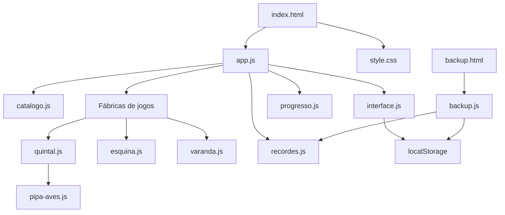

| Arquivo ou pasta | Responsabilidade |
|---|---|
| [dist/](dist/README.md) | Aplicação que pode ser servida diretamente por HTTP. |
| [index.html](dist/index.html) | Documento em português, barra de título, região de telas, rodapé e carregamento de módulos. |
| [audio.js](dist/audio.js) | Contexto de áudio, carregamento, cache, mixagem, loops e proteção contra corridas. |
| [configuracoes.js](dist/configuracoes.js) | Engrenagem, volumes persistentes e Sobre o projeto acessível. |
| [app.js](dist/app.js) | Estado das telas, seleção, ciclo de animação, entrada, áudio, pausa, resultado e avanço da volta. |
| [catalogo.js](dist/catalogo.js) | IDs estáveis, ordem das paradas, nomes, regras, comandos, nomes dos níveis, paletas de palco e tipo de controle. |
| [interface.js](dist/interface.js) | Ícones vetoriais em grade, escape de texto e leitura/gravação local com tratamento de indisponibilidade. |
| [quintal.js](dist/quintal.js) | Goteira, Maré Miúda, Último Fio e Pipa de Laje. |
| [esquina.js](dist/esquina.js) | Rádio de Pilha, Pão na Chapa, Rastro de Prata. |
| [varanda.js](dist/varanda.js) | Luz de Varanda, Três Petelecos, Pisca no Mato. |
| [pipa-aves.js](dist/pipa-aves.js) | Sprite das aves, formação do bando em V e colisão coerente com seus pixels. |
| [progresso.js](dist/progresso.js) | Migração da Volta por IDs, preservando correspondência após remoção de jogos. |
| [recordes.js](dist/recordes.js) | Validação de recordes, IDs permitidos e atualização apenas ao superar o melhor resultado. |
| [backup.js](dist/backup.js) e [backup.html](dist/backup.html) | Exportação/importação explícita, validação e restauração dos dados locais. |
| [pracinha.js](dist/pracinha.js) | Código legado fora do catálogo e sem entrada pelo aplicativo. |
| [scripts/](scripts/README.md) | Ferramenta histórica que gera somente os SVGs dos jogos retirados da Pracinha. Não regenera todas as artes. |
| [tests/](tests/README.md) | Verificação automática das regras, entradas e progressão. |
| [arte/](dist/arte/README.md) | Fonte, dez miniaturas, ícones atuais e recursos legados identificados. |
| [artes/](dist/artes/README.md) | Capa e marca oficiais, organizadas sem mover caminhos usados pela aplicação. |
| [docs/](docs/README.md) | Guias de publicação e regras/validação dos modos de cada módulo. |
| [.openai/](.openai/README.md) | Manifesto da instalação hospedada de referência. O servidor local só precisa de dist/. |

### Decisões e limites técnicos

- **Sem framework e sem build:** HTML, CSS e módulos ECMAScript nativos; nenhuma dependência de execução baixada de CDN.
- **Responsabilidades separadas:** navegação e entrada em `app.js`; regras e desenho em cada fábrica; persistência validada em módulos próprios.
- **Estado por instância:** repetir cria uma partida limpa; pausar conserva a instância e cancela entradas parciais. Fábricas não escrevem diretamente em `localStorage`.
- **Desenho independente da lógica:** sprites são blocos e linhas em Canvas; mapas e colisões não dependem de imagens PNG. O módulo das aves compartilha geometria entre desenho e colisão.
- **Custos controlados:** buscas têm limites e fallback; geração não roda por quadro. `requestAnimationFrame` e `ResizeObserver` cuidam do ciclo e do tamanho apresentado.
- **Limites assumidos:** dados locais editáveis, sem servidor de autenticação, anti-cheat ou ranking confiável. Não há promessa de desempenho igual em todos os celulares.

### Contrato de um minigame

O ID do catálogo seleciona uma fábrica. O terceiro argumento opcional `{mode, seed}` escolhe `classic`, `endless` ou `generated` e a semente reproduzível. `score()` informa a métrica do modo por recorde; as fábricas não gravam no armazenamento diretamente. Por exemplo, `jogos['goteira'](1, api)` cria uma rodada nova no primeiro nível. No exemplo abaixo, a chamada de desenho recebe o contexto 2D e o intervalo de atualização está em segundos.

```js
import { quintal } from './dist/quintal.js';

const rodada = quintal.goteira(1, {
  tone(frequencia, duracao) { /* encaminhar ao sintetizador */ },
  finish(venceu, mensagem) { console.log(venceu, mensagem); }
});

rodada.press('right');
rodada.update(1 / 60);
rodada.release('right');
// Com um contexto Canvas 2D válido, use rodada.draw(ctx).
console.log(rodada.hud());
```

| Operação | Contrato |
|---|---|
| press(dir), release(dir) | Recebem as direções normalizadas. Nos jogos de ação única, o comando normalizado é act; direcaoAcao restringe a tecla quando informado e acao nomeia o botão de toque. |
| update(dt) | Avança o tempo lógico e aplica regras, física, colisões ou contagens. |
| draw(ctx) | Desenha a cena no espaço lógico de 96 × 96. |
| hud() | Retorna o texto do indicador de tempo, progresso ou condição atual. |
| point(x,y,phase) | Opcional. Trata interação direta com a cena, inclusive arrastar a bolinha ou sintonizar o rádio. |
| cancelInput() | Opcional. Cancela uma ação parcial, como carregar um peteleco ao pausar. |
| api.finish(venceu,mensagem) | Encerra a rodada e entrega à interface o resultado que será exibido. |
| api.tone(hz,segundos) | Solicita um sinal sonoro curto quando o som está ativo. |

### Um quadro, do comando ao desenho

1. O teclado ou o ponteiro gera um evento. A interface o converte em direção ou em coordenadas lógicas da cena. Um mapa de fontes evita soltar prematuramente uma direção ainda pressionada por outro controle.
2. O relógio de `requestAnimationFrame` fornece o intervalo desde o quadro anterior. O aplicativo limita o passo a 0,08 s. A rodada recebe `update(dt)`.
3. Se a rodada continuar, o jogo desenha o quadro e atualiza o indicador quando o texto muda. Um `ResizeObserver` ajusta a apresentação ao espaço disponível. A resolução lógica continua em 96 × 96.
4. Uma vitória ou derrota chama `finish`. A interface cancela os quadros, libera os controles e apresenta o resultado. Pausar conserva a instância. Repetir cria outra.

---


</details>

## Trilha sonora e configurações

<details>
<summary>Expandir trilha sonora e configurações</summary>

**Bossa de Janela** é a trilha padrão: fole suave, violão dedilhado e baixo em um loop original de 16 compassos, a 82 BPM (46,829 s). O arquivo FLAC conserva exatamente as amostras PCM da V9, sem nova normalização, compressão dinâmica ou mudança de arranjo. Os timbres são sintetizados, sem gravações de instrumentistas. A escolha **Tarde na Tijuca** mantém integralmente as nove músicas anteriores, com cordas dedilhadas e percussão delicada: a primeira tela sonorizada escolhe seu tema e a navegação mantém essa faixa. Os nove efeitos 8-bit (opção B) permanecem independentes e inalterados.

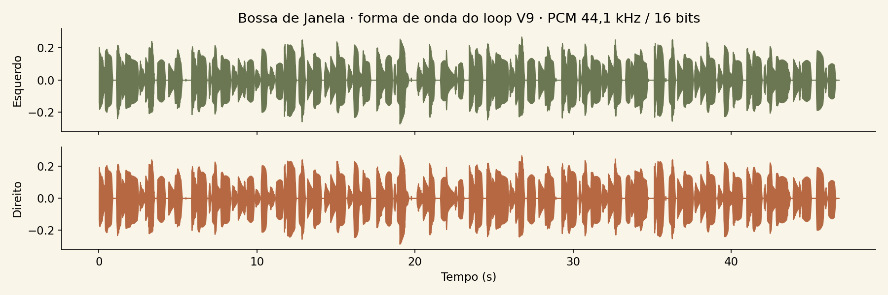

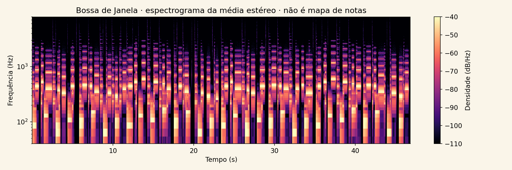

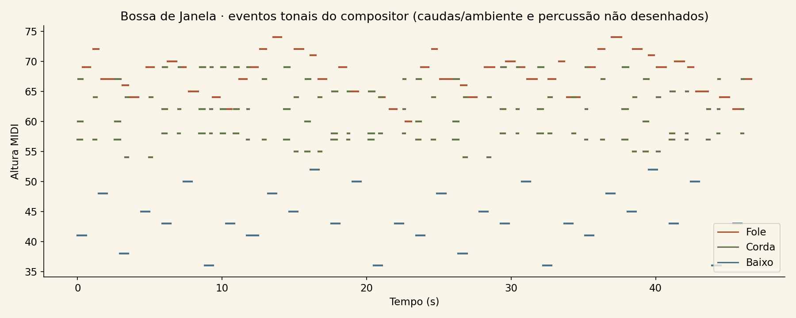

O mapa usa os eventos reais de fole, corda e baixo; não inclui percussão, reflexões de ambiente nem caudas além da duração de cada evento. O espectrograma representa energia por frequência, não identifica notas automaticamente.

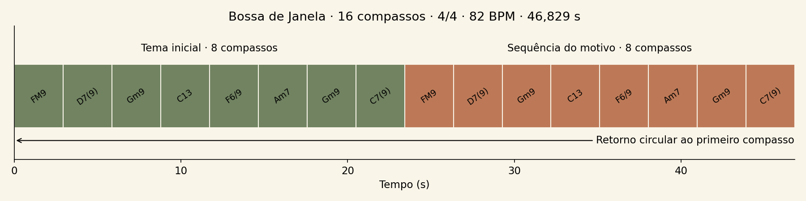

**Tarde na Tijuca — Interpretação Mais Natural.** As visualizações anteriores continuam abaixo, com os nove temas e os efeitos; os mapas documentam eventos reais do compositor, não uma transcrição inventada.

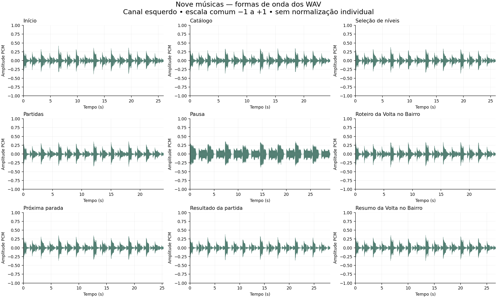

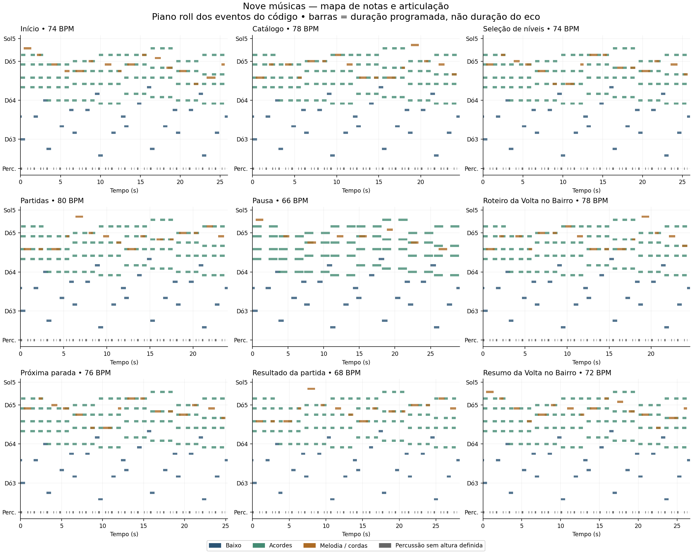

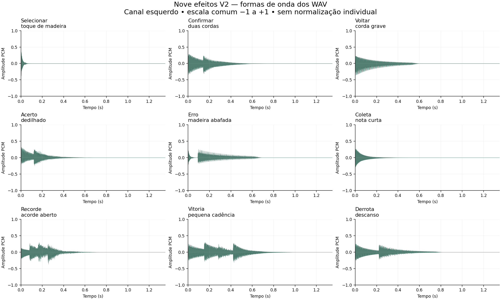

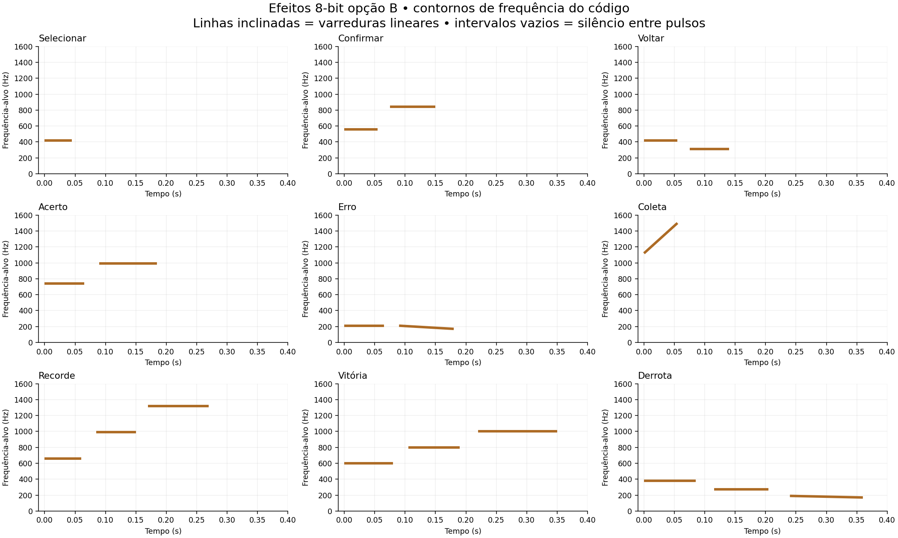

[Ouvir/baixar as músicas](dist/audio/musicas/) · [Efeitos](dist/audio/efeitos/) · [Formas de onda, notas, acordes e explicação completa](docs/audio/README.md) · [Código de composição](scripts/audio/README.md).

O aviso **© 2026 Luigi Scofano de Araujo** aparece no rodapé inicial e no Sobre, sem alterar a licença do repositório. O Sobre cita a obra e o artista em texto, sem link externo; a fonte de pesquisa está registrada na seção de identidade visual deste README.

A **engrenagem** abre Configurações: escolha da trilha, música e efeitos têm controles independentes (padrões 10% e 5%), botão para restaurar os volumes e **Sobre o projeto**. O botão de som continua silenciando tudo e mantém a preferência anterior. O som começa somente após interação; ocultar a aba o suspende. Pisca e Rádio preservam suas pistas sonoras, com música de fundo atenuada. Configurações pausam a partida; fechar não retoma o jogo involuntariamente.

---


</details>

## Configurações e Sobre o projeto

<details>
<summary>Expandir configurações e sobre o projeto</summary>

A engrenagem permanece na barra superior do início, catálogo, seletor, partida e pausa. Ela abre o mesmo painel sem abandonar o jogo selecionado.

| Controle | Comportamento |
|---|---|
| Trilha sonora | Alterna Bossa de Janela (padrão) e Tarde na Tijuca, salvando a escolha. |
| Música | Ajusta somente a trilha, de 0 a 100%. Padrão: **10%**. |
| Efeitos sonoros | Ajusta os efeitos, de 0 a 100%. Padrão: **5%**. |
| Restaurar volumes padrão | Retorna os dois controles a 10% e 5%; não apaga progresso ou recordes. |
| Botão de som na barra | Liga ou silencia o conjunto, conservando os volumes escolhidos. |
| Sobre o projeto | Expande o texto de apresentação, memórias, referência artística e aviso de armazenamento local. |
| Fechar | Fecha o painel; se a partida foi pausada, ela não reinicia sozinha. |

As preferências são locais a este navegador. Instalações novas e antigas sem uma escolha de trilha recebem Bossa de Janela; os volumes e o botão de som já salvos são preservados. A escolha viaja no backup de versão 4; importar backups anteriores mantém a escolha existente. Trocar de trilha guarda a posição de cada opção na sessão; navegar não reinicia a música. Entre abas, a última interação assume o áudio por canal de comunicação e trava exclusiva quando disponíveis; a janela externa continua tendo prioridade sobre a página que a abriu. A implementação está em [configuracoes.js](dist/configuracoes.js), com o áudio em [audio.js](dist/audio.js).

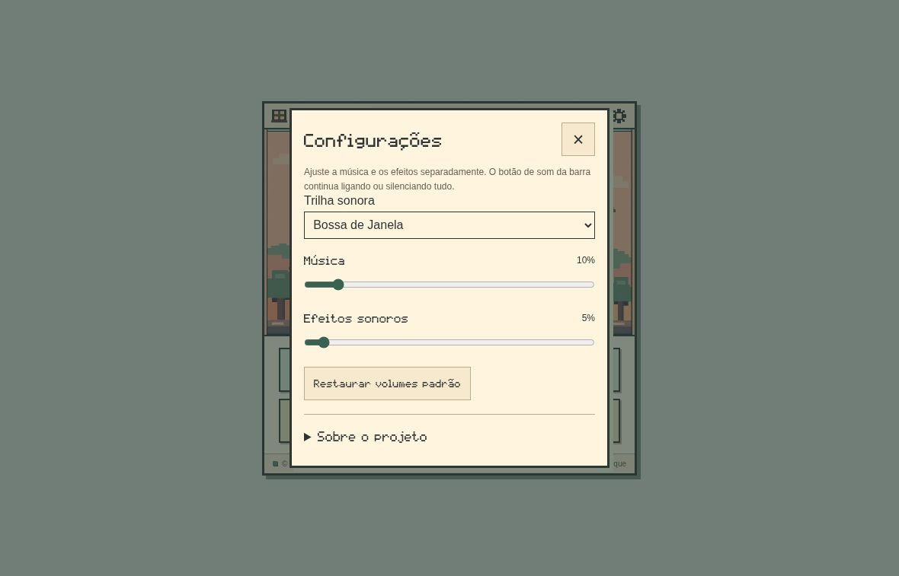

### Texto do Sobre

O painel apresenta o texto abaixo; a referência externa fica nesta documentação, não como link dentro do jogo.

> Miudezas reúne dez jogos de bairro em uma pequena janela. Cenas do cotidiano brasileiro viram desafios curtos de atenção, memória, coordenação e planejamento.
>
> Meus dois pais viveram a vida toda na Tijuca. Foi nesse bairro e nas minhas memórias de família que busquei inspiração para a identidade visual de Miudezas. Trouxe temas do cotidiano brasileiro para criar um jogo confortável e aconchegante, como essas lembranças.
>
> Entre essas memórias está a obra Balões ou Ritual do Vento, do escultor Gabriel Fonseca, que eu sempre via ao ir para a casa da minha avó na Tijuca. Suas formas e cores aparecem reinterpretadas em pixel art na capa, junto das casas, dos morros, da pipa e do bem-te-vi.
>
> Na imagem de abertura, dez janelinhas se espalham pelas casas do bairro. Cada uma representa um dos dez jogos de janela do Miudezas. É um detalhe pra descobrir aos poucos: de fora, a gente vê a vizinhança inteira; ao abrir uma janela, encontra uma brincadeira desse mesmo bairro.
>
> Quis transformar essas pequenas cenas em um lugar para desacelerar, explorar e brincar. A arte em pixels e a música suave acompanham esse sentimento de acolhimento.
>
> © 2026 Luigi Scofano de Araujo
>
> Progresso e preferências ficam neste navegador. Use o backup para guardar seus dados; não há conta nem sincronização automática.

| Sobre aberto | Continuação após rolar o painel |
|:---:|:---:|
|  |  |

Estas duas capturas mostram partes do mesmo painel rolável, sem montagem. A [referência artística e sua contextualização geográfica](#memórias-tijuca-e-cotidiano-brasileiro) distinguem a memória da Tijuca da localização da obra. Consulte também o [catálogo mantido pela família de Gabriel Fonseca](https://gabrielsculptor.com/about/).

---


</details>

## Dados e som

<details>
<summary>Expandir dados e som</summary>

| Chave local | Conteúdo | Momento de gravação |
|---|---|---|
| miudezas.v1.volumeMusica / volumeEfeitos | Inteiros entre 0 e 100; padrões 10/5. | Ao ajustar Configurações. |
| miudezas.v1.som | Booleano. O padrão é desligado. | Ao alternar o som na barra superior. |
| miudezas.v1.recordes | Melhores pontuações dos seis jogos Sem Parar, por ID. | Ao superar o recorde durante a partida e ao concluir. |
| miudezas.v1.volta | Objeto com nivel, ids e resultados booleanos, migrado por IDs. | No começo da volta e ao avançar de parada. Ao completar a última, o valor passa a null. |

Os seis recordes de Sem Parar, incluindo Luz de Varanda (`luz`), ficam em `miudezas.v1.recordes`, por ID de jogo, separados da volta e dos resultados autorais. O backup versão 4 inclui esse campo e aceita arquivos anteriores. Importar um backup antigo não deve apagar recordes já existentes. Os dados são locais ao navegador: limpar armazenamento ou trocar de dispositivo pode removê-los; use exportação/importação explícita. Não há conta, sincronização ou ranking inviolável.

Com `{"nivel":2,"resultados":[true,false]}`, a próxima parada é Último Fio em Animado. O resultado mais recente só entra no histórico ao escolher avançar. Repetir permite substituir a tentativa antes desse registro. A retomada depende da origem e do navegador. Outra cópia do site tem seu próprio histórico. Se o armazenamento estiver indisponível, a rodada segue em memória.

As trilhas são FLAC sem perdas, carregadas sob demanda, com transição de 300 ms e cache limitado. Efeitos 8-bit opção B usam WAV; sinais informativos preservam o oscilador de onda quadrada. O contexto de áudio é ativado após interação. Em Goteira, a nota sobe conforme o balde enche. Em Pisca no Mato, as duas alturas distinguem esquerda e direita. As transmissões do rádio têm legendas escritas.

---


</details>

## Manutenção e testes

<details>
<summary>Expandir manutenção e testes</summary>

**Onde editar.** Para alterar o tempo de uma rajada, edite a fábrica em quintal.js. Para alterar a explicação mostrada antes do jogo, edite catalogo.js. Uma mudança que altere a meta precisa aparecer nos dois lugares. Para revisar uma cor, identifique primeiro se ela pertence à interface, à margem do palco ou ao desenho da cena.

**Compatibilidade da volta.** O histórico antigo é migrado pela ordem original de IDs, ignorando apenas as paradas retiradas. Vitórias e tentativas dos jogos mantidos preservam sua correspondência. Novas voltas armazenam também seus IDs. O salvamento antigo não é apagado ao consultar a retomada. Total, paginação e resumo derivam de catalogo.length.

| Verificação reproduzível | Resultado esperado |
|---|---|
| Avulso → segunda página → Pisca no Mato → Sossegado | O jogo inicia normalmente e aceita a sequência. |
| Em Goteira, ficar fora do ralo depois de recolher quatro gotas | O indicador para em 4/4; a quinta gota transborda e molha o chão. Voltar ao ralo libera espaço. |
| Em Rastro de Prata, colher uma folha e voltar à casa anterior | O último segmento é desfeito e a folha volta à casa. |
| Em Três Petelecos, começar a carregar um tiro e pausar ou cancelar o ponteiro | Nenhum tiro involuntário; ao continuar, a bolinha espera um novo comando. |
| Na pausa, escolher Voltar às fases | A seleção do jogo é conservada, sem apagar saves ou recordes. |
| Em Luz de Varanda, errar três botes em qualquer dificuldade | Uma única derrota; o prazo das fases autorais continua valendo. Sem Parar permanece sem cronômetro. |
| Em Rastro, iniciar um arrasto fora do caracol | O gesto não move o caracol; teclado e botões continuam disponíveis. |
| Alternar para outra aba durante uma rodada | A tela de pausa interrompe o avanço do jogo. |
| Na Volta, avançar após Goteira, sair e retomar no mesmo navegador | A segunda parada é Maré Miúda no nível escolhido. |
| Completar o percurso, inclusive com uma tentativa perdida | O resumo distingue vitórias e tentativas nas 10 miniaturas. |
| Em telefone, tocar no pão, deslizar no tabuleiro e arrastar o dial | Cada gesto atua na cena correspondente e os botões também ficam disponíveis. |

Na auditoria documental após o PR #51, a suíte recebeu também uma verificação do texto das regras da lagartixa. Execute `node --test tests/*.test.mjs` para verificar catálogo, migração dos resultados, paginação, conclusão das 10 paradas, modos adicionais, geração reproduzível e regras de derrota/vitória. Os testes de Pracinha são de código legado, não indicam jogos disponíveis.

O teste rápido de sintaxe pode ser feito com Node recente, por exemplo `node --check dist/app.js`. Os cenários acima verificam comportamento e interação. O repositório inclui os testes automáticos e este roteiro de verificação manual.

---


</details>

## Publicação no GitHub Pages

<details>
<summary>Expandir publicação no github pages</summary>

**Site público:** [luigiscofano.github.io/Miudezas](https://luigiscofano.github.io/Miudezas/). O site não depende de o computador do autor estar ligado. O conteúdo servido é `dist/`, sem compilação ou backend.

O [workflow](.github/workflows/pages.yml) executa os testes e publica automaticamente após um push/merge em `main`; também permite `workflow_dispatch`. Uma alteração só deve ser anunciada como publicada após conferir a execução e a versão pública. [Histórico de execuções](https://github.com/luigiscofano/Miudezas/actions) · [Guia de publicação e reversão](docs/github-pages.md).

Para transferir progresso de outra origem, exporte pela página de backup naquela origem e importe na [página de backup do Pages](https://luigiscofano.github.io/Miudezas/backup.html). Domínios e navegadores não compartilham armazenamento automaticamente. A ferramenta valida schema e dados; backup versão 1 continua aceito, sem apagar recordes atuais ausentes no arquivo antigo. Não substitui conta ou sincronização.

---


</details>

## Mapa da documentação

<details>
<summary>Expandir mapa da documentação</summary>

| Guia | Conteúdo |
|---|---|
| [Índice técnico](docs/README.md) | Acesso aos manuais e organização do projeto. |
| [Acervo de artes](dist/artes/README.md) | Capa, marca, ligação com ícones e miniaturas. |
| [Design e arte em código](docs/design/README.md) | Origem, uso e manutenção dos assets e sprites reais. |
| [Histórico visual](docs/evolucao-visual.md) | Decisões e revisões anteriores, separadas do estado atual. |
| [Quintal](docs/jogos/quintal/README.md) | Goteira, Maré, Fio e Pipa. |
| [Esquina](docs/jogos/esquina/README.md) | Rádio, Pão e Rastro. |
| [Varanda](docs/jogos/varanda/README.md) | Lagartixa, Gude e Pisca. |
| [Dados](docs/dados/README.md) | Persistência, validação e compatibilidade de backup. |
| [Testes](tests/README.md) | Comandos, cobertura e roteiro manual. |

---


</details>

## Referências

<details>
<summary>Expandir referências</summary>

**Inspirações de criação.** As referências visuais partem das cenas e dos objetos dos jogos do catálogo. A moldura vem da ideia de um jogo de janela para computador. O bairro dá unidade a cenas que pedem gestos diferentes, como dar um peteleco, acertar o ponto do pão, ajustar um rádio e observar os vaga-lumes. O quintal do caracol traz o raciocínio espacial ao chão de ladrilhos. Esses exemplos descrevem as escolhas tomadas para Miudezas.

**Leitura técnica.** O Canvas explica a superfície de desenho usada pelas cenas. O agendamento de quadros explica o relógio de animação. A síntese dos sinais parte dos recursos nativos de áudio do navegador.

- [MDN — Canvas API](https://developer.mozilla.org/en-US/docs/Web/API/Canvas_API)
- [MDN — requestAnimationFrame](https://developer.mozilla.org/en-US/docs/Web/API/Window/requestAnimationFrame)
- [MDN — Web Audio API](https://developer.mozilla.org/en-US/docs/Web/API/Web_Audio_API)

**Créditos.** © 2026 Luigi Scofano de Araujo. [Texto da licença](LICENSE)


### Enquadramento dos jogos no computador

Em dispositivos com mouse, a largura da janela durante a partida acompanha a altura livre do tabuleiro quadrado. Isso remove as faixas laterais sem esticar os pixels, cortar a cena ou mudar coordenadas de controle. O ajuste reage ao redimensionamento e à altura do HUD, e é desfeito ao pausar ou voltar aos menus. Telas de toque mantêm o enquadramento anterior. Os testes de navegação cobrem os dez jogos, larguras de 492 a 1920 pixels, saída/retomada e preservação do toque; a simulação DOM não substitui avaliação em aparelho físico.

</details>

### Continuidade musical

A música acompanha a navegação sem reiniciar: o tema escolhido na primeira ativação do som permanece durante a sessão, inclusive em pausa, configurações e resultados. As nove composições continuam disponíveis como temas de entrada. Silenciar ou ocultar a aba guarda o ponto da faixa para a próxima interação; recarregar a página começa uma nova sessão. As pistas sonoras dos jogos e os volumes independentes são preservados.
