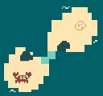
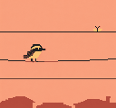
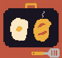
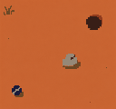
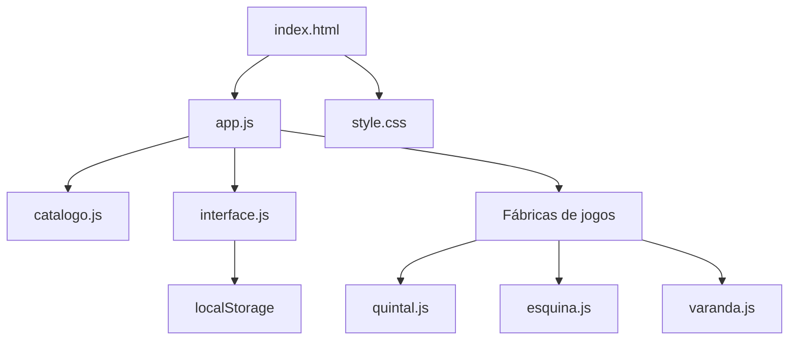

# Miudezas

<p align="center"></p>

**Dez jogos de bairro em uma janelinha.** Um balde quase cheio, uma mariposa no fio de cima, um ovo e um pão que douram em tempos diferentes. Em Miudezas, cada uma dessas cenas vira uma partida que se aprende olhando e se joga com poucas teclas ou um gesto.

<p align="center"></p>

| Coleção | Desafios | Tela de jogo | Plataforma |
|---|---|---|---|
| 10 minigames | 30 fases autorais + modos adicionais | Canvas de 96 × 96 pixels lógicos | Navegador de computador ou celular |

**Autor:** Luigi Scofano de Araujo · [Jogar no GitHub Pages](https://luigiscofano.github.io/Miudezas/) · [Licença MIT](LICENSE)

[Executar](#executar) · [Modos e telas](#modos-e-telas) · [Identidade visual](#identidade-visual) · [Jogos e level design](#jogos-e-level-design) · [Arquitetura](#arquitetura) · [Dados e som](#dados-e-som) · [Manutenção e testes](#manutenção-e-testes) · [Referências](#referências)

---

## Executar

A pasta `dist/` contém o próprio código-fonte executável. Basta servi-la por HTTP. A aplicação usa módulos JavaScript nativos, imagens e uma fonte local. A execução dispensa instalação de pacotes, compilação, banco de dados e chaves de API.

1. Baixe e extraia o repositório ou clone-o com Git.
2. Na raiz do projeto, execute um dos comandos abaixo com Python 3.
3. Abra **http://localhost:8000**. Para encerrar o servidor, pressione Ctrl+C no terminal.

```sh
python3 -m http.server 8000 --bind 127.0.0.1 --directory dist
```

No Windows com o inicializador Python:

```powershell
py -m http.server 8000 --bind 127.0.0.1 --directory dist
```

Para experimentar no celular, conecte os dois aparelhos à mesma rede local, execute o servidor com `--bind 0.0.0.0` e abra no celular o endereço IP local do computador na porta 8000. Para hospedar uma cópia, use o conteúdo de `dist/` como raiz do servidor estático. O endereço oficial no GitHub Pages é público e pode ser aberto em outros computadores ou celulares. A cópia local roda diretamente.

## Modos e telas

| Tela | O que se faz nela |
|---|---|
| Início | Escolher entre uma partida avulsa e a sequência. A barra oferece som e abertura da janela no desktop. |
| Galeria | Percorrer duas páginas com até seis miniaturas cada. A ordem segue o percurso do bairro. |
| Roteiro | Ver as dez paradas. Com progresso salvo, escolher entre retomar e iniciar uma nova volta. |
| Seleção de nível | Escolher **Sossegado**, **Animado** ou **Puxado**, além do modo adicional nos jogos elegíveis. As fases autorais permanecem disponíveis. |
| Próxima parada | Ler o objetivo e os comandos antes de iniciar o relógio do jogo. |
| Partida | Ver a cena, a meta ou o tempo no indicador e os botões correspondentes àquela mecânica. |
| Pausa | Consultar regras, continuar, **Voltar às fases** ou sair ao menu. Voltar às fases preserva o jogo selecionado e os dados salvos, sem registrar uma derrota artificial. Perder o foco ou ocultar a aba também pausa a partida. |
| Resultado | No avulso, repetir ou voltar à galeria. Na volta, repetir a parada ou avançar mesmo depois de uma derrota. |
| Resumo | Após a 10ª parada, ver os desafios vencidos e as dez miniaturas com seus resultados. |

### Modos adicionais por jogo

São **seis jogos com Sem Parar e três com Caminho Novo**, além do Rádio com fases autorais. Os modos adicionais são partidas avulsas; a Volta no Bairro continua nas três dificuldades autorais. **Sem Parar** não tem meta final nem cronômetro de encerramento: superar o recorde não encerra a partida. **Caminho Novo** gera uma fase completa; repetir mantém a semente e gerar outra cria um percurso novo.

| Jogo | Modo adicional | Métrica ou razão |
|---|---|---|
| Goteira | Sem Parar | Gotas recolhidas até alagar o chão. |
| Maré Miúda | Caminho Novo | Percurso validado considerando passos, maré e última areia segura. |
| Último Fio | Sem Parar | Mariposas recolhidas até uma rajada atingir o fio ocupado. |
| Pipa de Laje | Sem Parar | Obstáculos superados até colidir. |
| Rádio de Pilha | Clássico | História finita em três transmissões; repetição arbitrária não melhora a proposta. |
| Pão na Chapa | Sem Parar | Alimentos corretos até o terceiro erro. |
| Rastro de Prata | Caminho Novo | Trilha sem cruzar o próprio rastro, com três folhas antes do vaso. |
| Luz de Varanda | Sem Parar | Mosquitos capturados pela lagartixa; o terceiro bote errado encerra, sem prazo final. |
| Três Petelecos | Caminho Novo | Percurso validado com a física e os controles de lançamento reais. |
| Pisca no Mato | Sem Parar | Maior sequência concluída; errar encerra. |

No **Rastro de Prata**, Caminho Novo combina a família estreita já existente com uma família mais aberta: áreas de escolha, bifurcações e praças aumentam as alternativas, mas o rastro exige planejamento. A família aberta mantém solução certificada e rejeita atalhos curtos; ambas continuam disponíveis no gerador.

Caminho Novo toma a dificuldade **Puxado** como referência de desafio, preservando as três fases autorais. Os geradores usam sementes reproduzíveis, tentativas limitadas e configurações de reserva validadas. A prova de solução é executada antes da entrega da fase, não presumida apenas pela aparência do mapa. Consulte [Quintal](docs/jogos/quintal/README.md), [Esquina](docs/jogos/esquina/README.md) e [Varanda](docs/jogos/varanda/README.md) para regras, limites e verificações.

**Uma volta de exemplo.** Escolha Animado, jogue Goteira e avance. O próximo cartão é Maré Miúda no mesmo nível. Fechar o navegador nesse cartão permite retomar na segunda parada. Se sair no meio da partida, ela recomeça naquela parada. O avanço registra um resultado por jogo.

### Controles diretos e alternativa acessível

O gesto principal atua sobre o objeto do jogo: em **Rastro de Prata**, comece no caracol e trace pelas casas vizinhas; em **Três Petelecos**, comece sobre a bolinha, puxe e solte para lançar. Começar fora desses objetos não inicia um arrasto válido. Interrupções como `pointercancel` ou perda de foco cancelam o lançamento parcial: não equivalem a soltar voluntariamente a bolinha.

Teclado e botões direcionais continuam sendo alternativas acessíveis; não é necessário dominar o arrasto para jogar. A restrição de gestos nativos (`touch-action`) fica limitada ao tabuleiro interativo, sem bloquear a rolagem da página inteira. Confira também foco visível, leitura das instruções e funcionamento em telas estreitas.

**Comandos gerais.** Setas e WASD têm a mesma função nas partidas. Nos menus, use setas para navegar e Enter para selecionar. Esc volta ou pausa. No celular, os botões sob a cena complementam os gestos próprios de cada jogo. O computador solicita uma janela de 492 × 492 quando a área tem ao menos 700 px de largura e o dispositivo aponta com precisão. Se o navegador bloquear a abertura, o jogo segue na página.

## Identidade visual

O nome **Miudezas** reúne acontecimentos pequenos o bastante para caber numa janela. A capa os situa no mesmo bairro. O bem-te-vi pousa no telhado com uma nota musical; a linha da pipa parte de trás de uma casa. As fachadas, árvores apoiadas no chão e montanhas evocam a Tijuca. Um Cristo discreto e uma interpretação do Ritual do Vento completam a paisagem. Uma janela verde com a letra M funciona como ícone do conjunto, inclusive na aba do navegador.

| Elemento | Aplicação e critério |
|---|---|
| Moldura | Contorno escuro, barra clara e sombra deslocada lembram uma janela de computador. A moldura separa a interface persistente das cores próprias de cada cena. |
| Tipografia | **Miudezas Pixel**, fonte local com acentos, identifica títulos, níveis e comandos. Verdana, Arial e a fonte sem serifa do sistema sustentam regras e textos corridos. |
| Escala | A cena ativa é desenhada em 96 × 96 e ampliada com pixels aparentes. As dez miniaturas ativas têm 128 × 120; a capa aprovada 1672 × 941 e o ícone verde aprovado 390 × 390. |
| Silhueta | Asa curta e peito amarelo identificam o pássaro. Um retângulo de água sob a rachadura avisa onde a gota vai cair. Cada detalhe precisa continuar legível no tamanho da janela. |
| Pequenas irregularidades | A alça do balde cai de lado, a antena do rádio dobra e as fachadas variam um pixel. A irregularidade pertence ao objeto. As áreas de toque e as regras continuam previsíveis. |
| Sinais de jogo | O fio treme antes da rajada, o pão muda de cor e solta vapor, a luz do rádio indica sintonia. Sons curtos confirmam ações, enquanto o indicador escrito conserva a informação principal. |

### Paleta da interface

| Uso | Cor | Onde aparece |
|---|---|---|
| Tinta | `#2E3535` | Texto principal, contorno da janela e botões |
| Papel | `#FFF5DF` | Fundo das telas de leitura |
| Creme | `#F7E9CD` | Barra superior, rodapé e controles secundários |
| Borda | `#B9AD8E` | Separação de grupos e opções |
| Verde | `#386251` | Ação principal e nível selecionado |
| Texto secundário | `#655D50` | Instruções e detalhes |
| Ouro | `#F4BF64` | Resposta ao pressionar o controle |
| Área de trabalho | `#DCE1D4` | Fundo pontilhado em volta da janela |

As cores de cada palco aparecem nas fichas abaixo. São as cores de enquadramento definidas pelo catálogo. Os sprites e fundos internos têm paletas próprias nas funções de desenho. [Folha de estilos](dist/style.css) · [Catálogo](dist/catalogo.js) · [Acervo visual](dist/arte/README.md)

---

## Jogos e level design

Cada ficha mostra a miniatura usada pela galeria, o objetivo, os comandos e a diferença implementada entre os três níveis. Nos jogos de tempo, a dificuldade altera a margem de reação. Nos de percurso, ela altera o mapa. Nos de memória, amplia o que o jogador precisa reter.

### 01 · Goteira


Pegue as gotas por um minuto. O balde comporta quatro. Encoste no ralo à esquerda para esvaziá-lo. **Comandos.** ← e → movem o balde. No celular, segure um lado da cena.

| Sossegado | Animado | Puxado |
|---|---|---|
| **Chuva fina** · Intervalo de 1,85 s, queda a 27 px/s | **Chuva firme** · 1,52 s e 34 px/s | **Temporal** · 1,20 s e 40 px/s |

A gota espera 0,55 s na rachadura. O balde guarda quatro: a quinta transborda para o chão sem aumentar o conteúdo. Gotas não recolhidas também molham o piso, uma contagem por gota. Os limites são **12, 9 e 6 gotas no chão**, respectivamente; ao atingir o limite, aparece **“O chão alagou!”** e a partida termina. Ir ao ralo libera capacidade. Nas fases autorais, sobreviver aos 60 s e captar pelo menos uma gota conta como vitória. Em **Sem Parar**, o limite é 8 gotas no chão e não há encerramento por tempo.

Palco `#172244` · [Implementação de Goteira](dist/quintal.js)

### 02 · Maré Miúda

O caranguejo jogável usa a arte aprovada em pixel art: pinças simétricas, olhos definidos e destaque discreto na carapaça, dentro da célula original. A mudança é exclusivamente visual; regras, fases e saves permanecem iguais.




Leve o caranguejo até a concha. A maré muda a cada três passos. Se ela cobrir seus pés, você volta à areia. **Comandos.** Use as quatro direções ou deslize o dedo na cena.

| Sossegado | Animado | Puxado |
|---|---|---|
| **Enseada** · Mapa 8 × 8 com banco raso contínuo | **Dois baixios** · Mapa 8 × 8 com dois baixios separados | **Canal estreito** · Mapa 8 × 8 com passagens rasas estreitas |

Apenas um passo válido avança a maré. No terceiro, se a água subir sobre uma casa rasa, o caranguejo retorna à última casa firme. Um passo lateral na areia pode preparar o momento da travessia. Em Caminho Novo, o Puxado fornece a referência: 17 comandos mínimos e três comandos de custo da maré. Os mapas aceitos exigem 17 a 27 comandos, dois baixios indispensáveis e pedras cuja remoção encurtaria a solução. A busca considera o ciclo da maré e a última areia segura. [Critérios completos](docs/jogos/quintal/README.md#maré-miúda-prova-executável-de-solução).

Palco `#205E60` · [Implementação de Maré Miúda](dist/quintal.js)

### 03 · Último Fio



Pegue cinco mariposas. Quando um fio tremer, pule para outro antes da rajada. **Comandos.** ← e → dão pulinhos. ↑ e ↓ trocam de fio. No celular, deslize.

| Sossegado | Animado | Puxado |
|---|---|---|
| **Brisa** · Fio avisa com 1,65 s | **Vento de tarde** · Aviso de 1,25 s | **Ventania** · Aviso de 0,92 s |

Os três fios dividem a altura em linhas e cada uma tem nove posições. A mariposa indica o destino, mas o tremor muda a prioridade. Estar no fio ameaçado no fim do aviso encerra a rodada.

Palco `#E9A17E` · [Implementação de Último Fio](dist/quintal.js)

### 04 · Pipa de Laje


Chegue à última laje com a rabiola inteira. Passe entre os postes e os pássaros. **Comandos.** ↑ solta linha e ↓ recolhe. No celular, segure a parte de cima ou de baixo.

| Sossegado | Animado | Puxado |
|---|---|---|
| **Laje vizinha** · 4 obstáculos, cenário a 14 px/s | **Fim da rua** · 5 obstáculos, 17 px/s | **Outro quarteirão** · 6 obstáculos, 20 px/s |

Postes limitam a passagem por baixo e pássaros ocupam a parte alta. Casas estreitas, janelas altas, telhas e morros compõem o cenário carioca, sem colisão com elementos decorativos. A pipa responde gradualmente e o vento varia. Nas fases Sossegado, Animado e Puxado, aberturas altas e baixas se alternam, exigindo subir e descer. As margens diminuem de 8 para 7 e 6 pixels e a velocidade cresce; ficar numa única altura não resolve a fase. Uma colisão prende a rabiola. O modo Sem Parar mantém sua configuração anterior.

Palco `#60C3BD` · [Implementação de Pipa de Laje](dist/quintal.js)

### 05 · Rádio de Pilha


Encontre três estações antes que a pilha acabe. Quando a luz firmar, pare para ouvir. **Comandos.** ← e → ajustam o ponteiro. No celular, arraste pelo mostrador.

| Sossegado | Animado | Puxado |
|---|---|---|
| **Sinal forte** · 52 s de pilha, tolerância de 4,2% do dial | **Pouca pilha** · 44 s e 3,2% | **Sinal distante** · 36 s e 2,3% |

As estações ficam em 18%, 54% e 83% do mostrador. Pare por 0,58 s na faixa. Cada transmissão dura 2,2 s e suspende o gasto da bateria. As três, do canário desaparecido ao estúdio, formam uma pequena história.

Palco `#4F2A48` · [Implementação de Rádio de Pilha](dist/esquina.js)

### 06 · Pão na Chapa



Use **espátula no ovo** e **pinça no pão**. Selecione o utensílio por clique/toque ou pelas teclas **1 e 2**, depois clique/toque no alimento. **← e →** continuam recolhendo o lado correspondente com o utensílio selecionado. Os botões informam alimento, posição e ponto, além dos sinais em pixel art.

| Ritmo | Meta | Preparo do pão / ovo | No ponto | Tostado (última chance) |
|---|---|---|---|---|
| Sossegado | 3 ovos + 3 pães | 4,60 / 4,95 s | 2,80 s | 1,20 s |
| Animado | 4 ovos + 4 pães | 3,50 / 3,85 s | 1,90 s | 0,90 s |
| Puxado | 5 ovos + 5 pães | 2,60 / 2,95 s | 1,30 s | 0,70 s |

Há sempre um ovo e um pão, com relógios e identidades próprios. O pão inicial já tem 1,2 s de preparo para escalonar as escolhas. Após duas reposições, os alimentos trocam de lado; o aviso **“Troca de lados!”** acompanha uma pausa de 0,75 s no cozimento e na coleta. O estado dos alimentos é conservado, sem movimento contínuo que atrapalhe a leitura.

- **Vitória:** complete as duas metas em até um minuto de chapa ativa. O último recolhimento encerra imediatamente; não é preciso esperar o relógio.
- **Derrota:** o terceiro erro ou o prazo esgotado sem ambas as metas encerra a fase; “Jogar de novo” inicia uma tentativa limpa (ou “Repetir parada” na Volta no Bairro).
- **Erro:** deixar queimar ou usar o utensílio errado. Um queimado conta uma única vez e é reposto após 0,85 s. A tentativa com utensílio errado também repõe aquele alimento, sem cobrar uma queima adicional.
- **Cru:** a coleta é ignorada com aviso, sem inventar uma terceira penalidade. **Tostado:** ainda pode ser servido antes de queimar.
- **Sem Parar:** sem metas nem prazo final, com uma pontuação por alimento correto e derrota no terceiro erro. A velocidade cresce gradualmente até 125% da inicial.
- **Progresso:** resultados anteriores e a Volta no Bairro permanecem compatíveis; os recordes adicionais são separados por jogo.


Palco `#A25843` · [Implementação de Pão na Chapa](dist/esquina.js)


### 07 · Rastro de Prata


Pegue três folhas e entre no vaso. Seu rastro bloqueia o caminho. Volte pela última casa para desfazer o passo. **Comandos.** Use as quatro direções como alternativa ou inicie no caracol e trace o percurso pelas casas vizinhas com mouse ou toque.

| Sossegado | Animado | Puxado |
|---|---|---|
| **Quintal 5 × 5** · Tabuleiro de 5 × 5 | **Quintal 6 × 6** · Tabuleiro de 6 × 6 | **Quintal 7 × 7** · Tabuleiro de 7 × 7 |

O caminho ocupa as casas percorridas. Refazer o último passo desfaz também a coleta realizada naquela casa. Para entrar no vaso, recolha todas as três folhas no caminho atual. Caminho Novo usa o Puxado como referência e valida as restrições do rastro, não apenas a conectividade do tabuleiro. [Geração e testes](docs/jogos/esquina/README.md).

Palco `#C18E86` · [Implementação de Rastro de Prata](dist/esquina.js)

### 08 · Luz de Varanda


Espere a lagartixa apontar para um mosquito e dê o bote. Alcance a meta antes de a lâmpada apagar. **Comandos.** Aperte uma seta ou toque na cena para dar o bote.

| Sossegado | Animado | Puxado |
|---|---|---|
| **2 mosquitos** · 2 capturas em 25 s | **3 mosquitos** · 3 capturas em 24 s | **4 mosquitos** · 4 capturas em 23 s |

A cabeça da lagartixa varre um arco. O jogador decide o instante do bote. Em níveis altos, a mira gira mais depressa e o ângulo de acerto também fica menor. Em **Sem Parar**, não há prazo de encerramento: cada mosquito capturado soma um ponto e o terceiro bote errado encerra a partida. As fases autorais mantêm suas metas e tempos.

Palco `#30234B` · [Implementação de Luz de Varanda](dist/varanda.js)

### 09 · Três Petelecos



Acerte o buraco em até três petelecos. Quanto mais tempo segurar a direção, mais longe a bolinha vai. **Comandos.** Segure uma seta e solte. Com mouse ou toque, inicie na bolinha, puxe para trás e solte; cancelar o gesto não lança.

| Sossegado | Animado | Puxado |
|---|---|---|
| **Terra batida** · Alvo (77,20), uma pedra | **Entre pedras** · Alvo (78,19), duas pedras | **Caminho torto** · Alvo (78,18), duas pedras em novas posições |

Nas três fases autorais, a bolinha parte de (16,80), com as coordenadas medidas a partir do canto superior esquerdo. No Caminho Novo, posição inicial, alvo, disposição das pedras e família do percurso variam: há travessias e retornos, oito orientações e duas a quatro pedras. O validador usa a origem real de cada fase e testa a mesma física com teclado e toque; a variação não se limita a mover o buraco alguns pixels. Segurar define alcance no teclado e puxar define direção e alcance no toque. As pedras e limites desviam a trajetória. O buraco precisa ser alcançado até o terceiro tiro. Caminho Novo compara seu desafio com Puxado e valida uma solução executável na física real. [Critérios e limitações](docs/jogos/varanda/README.md).

Palco `#BE7749` · [Implementação de Três Petelecos](dist/varanda.js)


### 10 · Pisca no Mato


Observe os vaga-lumes e repita as piscadas na ordem. A cada acerto a sequência ganha uma luz. **Comandos.** ← acende o da esquerda e → o da direita. No celular, toque no vaga-lume.

| Sossegado | Animado | Puxado |
|---|---|---|
| **3 piscadas** · 3 piscadas, pulso de 0,525 s | **4 piscadas** · 4 piscadas, pulso de 0,470 s | **5 piscadas** · 5 piscadas, pulso de 0,415 s |

Uma piscada é acrescentada após cada sequência correta. O vaga-lume esquerdo soa a 392 Hz e o direito a 587 Hz. O jogador responde depois da demonstração. Trocar a ordem encerra a partida.

Palco `#1A393B` · [Implementação de Pisca no Mato](dist/varanda.js)


## Arquitetura

O navegador carrega o HTML e o módulo principal. A navegação usa elementos HTML, o cenário usa Canvas 2D e cada fábrica de jogo mantém o próprio estado em uma closure. Isso permite pausar uma rodada conservando o balde, a trilha do caracol ou a posição do ponteiro do rádio.



| Arquivo ou pasta | Responsabilidade |
|---|---|
| [dist/](dist/README.md) | Aplicação que pode ser servida diretamente por HTTP. |
| [index.html](dist/index.html) | Documento em português, barra de título, região de telas, rodapé e carregamento de módulos. |
| [app.js](dist/app.js) | Estado das telas, seleção, ciclo de animação, entrada, áudio, pausa, resultado e avanço da volta. |
| [catalogo.js](dist/catalogo.js) | IDs estáveis, ordem das paradas, nomes, regras, comandos, nomes dos níveis, paletas de palco e tipo de controle. |
| [interface.js](dist/interface.js) | Ícones vetoriais em grade, escape de texto e leitura/gravação local com tratamento de indisponibilidade. |
| [quintal.js](dist/quintal.js) | Goteira, Maré Miúda, Último Fio e Pipa de Laje. |
| [esquina.js](dist/esquina.js) | Rádio de Pilha, Pão na Chapa, Rastro de Prata. |
| [varanda.js](dist/varanda.js) | Luz de Varanda, Três Petelecos, Pisca no Mato. |
| [pracinha.js](dist/pracinha.js) | Código legado fora do catálogo e sem entrada pelo aplicativo. |
| [scripts/](scripts/README.md) | Geração de miniaturas a partir dos desenhos jogáveis. |
| [tests/](tests/README.md) | Verificação automática das regras, entradas e progressão. |
| [arte/](dist/arte/README.md) | Fonte, ícone, capa e 10 miniaturas. Os sprites durante as partidas são desenhados pelos módulos de jogo. |
| [docs/](docs/README.md) | Guias de publicação e regras/validação dos modos de cada módulo. |
| [.openai/](.openai/README.md) | Manifesto da instalação hospedada de referência. O servidor local só precisa de dist/. |

### Contrato de um minigame

O ID do catálogo seleciona uma fábrica. O terceiro argumento opcional `{mode, seed}` escolhe `classic`, `endless` ou `generated` e a semente reproduzível. `score()` informa a métrica do modo por recorde; as fábricas não gravam no armazenamento diretamente. Por exemplo, `jogos['goteira'](1, api)` cria uma rodada nova no primeiro nível. No exemplo abaixo, a chamada de desenho recebe o contexto 2D e o intervalo de atualização está em segundos.

```js
import { quintal } from './dist/quintal.js';

const rodada = quintal.goteira(1, {
  tone(frequencia, duracao) { /* encaminhar ao sintetizador */ },
  finish(venceu, mensagem) { console.log(venceu, mensagem); }
});

rodada.press('right');
rodada.update(1 / 60);
rodada.release('right');
// Com um contexto Canvas 2D válido, use rodada.draw(ctx).
console.log(rodada.hud());
```

| Operação | Contrato |
|---|---|
| press(dir), release(dir) | Recebem as direções normalizadas. Nos jogos de ação única, o comando normalizado é act; direcaoAcao restringe a tecla quando informado e acao nomeia o botão de toque. |
| update(dt) | Avança o tempo lógico e aplica regras, física, colisões ou contagens. |
| draw(ctx) | Desenha a cena no espaço lógico de 96 × 96. |
| hud() | Retorna o texto do indicador de tempo, progresso ou condição atual. |
| point(x,y,phase) | Opcional. Trata interação direta com a cena, inclusive arrastar a bolinha ou sintonizar o rádio. |
| cancelInput() | Opcional. Cancela uma ação parcial, como carregar um peteleco ao pausar. |
| api.finish(venceu,mensagem) | Encerra a rodada e entrega à interface o resultado que será exibido. |
| api.tone(hz,segundos) | Solicita um sinal sonoro curto quando o som está ativo. |

### Um quadro, do comando ao desenho

1. O teclado ou o ponteiro gera um evento. A interface o converte em direção ou em coordenadas lógicas da cena. Um mapa de fontes evita soltar prematuramente uma direção ainda pressionada por outro controle.
2. O relógio de `requestAnimationFrame` fornece o intervalo desde o quadro anterior. O aplicativo limita o passo a 0,08 s. A rodada recebe `update(dt)`.
3. Se a rodada continuar, o jogo desenha o quadro e atualiza o indicador quando o texto muda. Um `ResizeObserver` ajusta a apresentação ao espaço disponível. A resolução lógica continua em 96 × 96.
4. Uma vitória ou derrota chama `finish`. A interface cancela os quadros, libera os controles e apresenta o resultado. Pausar conserva a instância. Repetir cria outra.

## Dados e som

| Chave local | Conteúdo | Momento de gravação |
|---|---|---|
| miudezas.v1.som | Booleano. O padrão é desligado. | Ao alternar o som na barra superior. |
| miudezas.v1.volta | Objeto com nivel, ids e resultados booleanos, migrado por IDs. | No começo da volta e ao avançar de parada. Ao completar a última, o valor passa a null. |

Os seis recordes de Sem Parar, incluindo Luz de Varanda (`luz`), ficam em `miudezas.v1.recordes`, por ID de jogo, separados da volta e dos resultados autorais. O backup versão 2 inclui esse campo e aceita arquivos anteriores. Importar um backup antigo não deve apagar recordes já existentes. Os dados são locais ao navegador: limpar armazenamento ou trocar de dispositivo pode removê-los; use exportação/importação explícita. Não há conta, sincronização ou ranking inviolável.

Com `{"nivel":2,"resultados":[true,false]}`, a próxima parada é Último Fio em Animado. O resultado mais recente só entra no histórico ao escolher avançar. Repetir permite substituir a tentativa antes desse registro. A retomada depende da origem e do navegador. Outra cópia do site tem seu próprio histórico. Se o armazenamento estiver indisponível, a rodada segue em memória.

O áudio usa um oscilador de onda quadrada com envelope curto. O contexto de áudio é ativado após interação. Em Goteira, a nota sobe conforme o balde enche. Em Pisca no Mato, as duas alturas distinguem esquerda e direita. As transmissões do rádio têm legendas escritas.

## Manutenção e testes

**Onde editar.** Para alterar o tempo de uma rajada, edite a fábrica em quintal.js. Para alterar a explicação mostrada antes do jogo, edite catalogo.js. Uma mudança que altere a meta precisa aparecer nos dois lugares. Para revisar uma cor, identifique primeiro se ela pertence à interface, à margem do palco ou ao desenho da cena.

**Compatibilidade da volta.** O histórico antigo é migrado pela ordem original de IDs, ignorando apenas as paradas retiradas. Vitórias e tentativas dos jogos mantidos preservam sua correspondência. Novas voltas armazenam também seus IDs. O salvamento antigo não é apagado ao consultar a retomada. Total, paginação e resumo derivam de catalogo.length.

| Verificação reproduzível | Resultado esperado |
|---|---|
| Avulso → segunda página → Pisca no Mato → Sossegado | O jogo inicia normalmente e aceita a sequência. |
| Em Goteira, ficar fora do ralo depois de recolher quatro gotas | O indicador para em 4/4; a quinta gota transborda e molha o chão. Voltar ao ralo libera espaço. |
| Em Rastro de Prata, colher uma folha e voltar à casa anterior | O último segmento é desfeito e a folha volta à casa. |
| Em Três Petelecos, começar a carregar um tiro e pausar ou cancelar o ponteiro | Nenhum tiro involuntário; ao continuar, a bolinha espera um novo comando. |
| Na pausa, escolher Voltar às fases | A seleção do jogo é conservada, sem apagar saves ou recordes. |
| Em Luz de Varanda Sem Parar, errar três botes | Uma única derrota, sem encerramento por tempo antes dela. |
| Em Rastro, iniciar um arrasto fora do caracol | O gesto não move o caracol; teclado e botões continuam disponíveis. |
| Alternar para outra aba durante uma rodada | A tela de pausa interrompe o avanço do jogo. |
| Na Volta, avançar após Goteira, sair e retomar no mesmo navegador | A segunda parada é Maré Miúda no nível escolhido. |
| Completar o percurso, inclusive com uma tentativa perdida | O resumo distingue vitórias e tentativas nas 10 miniaturas. |
| Em telefone, tocar no pão, deslizar no tabuleiro e arrastar o dial | Cada gesto atua na cena correspondente e os botões também ficam disponíveis. |

Execute `node --test tests/*.test.mjs` para verificar catálogo, migração dos resultados, paginação, conclusão das 10 paradas, modos adicionais, geração reproduzível e regras de derrota/vitória. Os testes de Pracinha são de código legado, não indicam jogos disponíveis.

O teste rápido de sintaxe pode ser feito com Node recente, por exemplo `node --check dist/app.js`. Os cenários acima verificam comportamento e interação. O repositório inclui os testes automáticos e este roteiro de verificação manual.

## Referências

**Inspirações de criação.** As referências visuais diretas são as prévias aprovadas dos jogos mantidos. A moldura vem da ideia de um jogo de janela para computador. O bairro dá unidade a cenas que pedem gestos diferentes, como dar um peteleco, acertar o ponto do pão, ajustar um rádio e observar os vaga-lumes. O quintal do caracol traz o raciocínio espacial ao chão de ladrilhos. Esses exemplos descrevem as escolhas tomadas para Miudezas.

**Leitura técnica.** O Canvas explica a superfície de desenho usada pelas cenas. O agendamento de quadros explica o relógio de animação. A síntese dos sinais parte dos recursos nativos de áudio do navegador.

- [MDN — Canvas API](https://developer.mozilla.org/en-US/docs/Web/API/Canvas_API)
- [MDN — requestAnimationFrame](https://developer.mozilla.org/en-US/docs/Web/API/Window/requestAnimationFrame)
- [MDN — Web Audio API](https://developer.mozilla.org/en-US/docs/Web/API/Web_Audio_API)

**Créditos.** © 2026 Luigi Scofano de Araujo. [Texto da licença](LICENSE)


## Artes do jogo e capa aprovada

A [pasta de artes](dist/artes/README.md) reúne a documentação da nova capa e aponta para os demais recursos visuais. A [capa Tijuca](dist/artes/capas/miudezas-tijuca.png) é o arquivo aprovado, preservado sem recortes: título com iluminação em blocos de pixels, bem-te-vi com nota musical, pipa sobre os telhados e referência escultórica ao Ritual do Vento. A referência é uma interpretação artística, não uma reprodução documental do monumento.

A aplicação exibe a composição inteira com `object-fit: contain`, sem esticar a imagem nem sobrepor outro título. O título textual continua disponível para tecnologias assistivas. A alteração não modifica catálogo, regras, controles ou progresso salvo. A antiga paisagem `dist/arte/bairro.png` permanece apenas como recurso legado, sem uso na abertura.

### Logotipo e ícone


A [documentação da marca](dist/artes/marca/README.md) apresenta o logotipo principal, a janela verde e suas aplicações. Os PNGs são recortes fiéis da prancha aprovada, não redesenhos. A marca aparece na barra dos menus e o nome do jogo continua visível durante cada partida.

### Janela original da interface


A janela original permanece ao lado da marca na barra superior. O ícone verde aprovado continua sendo o favicon. Veja [arquivos e aplicações](dist/artes/marca/README.md).

## GitHub Pages e transferência de progresso

A migração preserva os arquivos do jogo e acrescenta um workflow manual de publicação. Consulte o [guia completo de GitHub Pages](docs/github-pages.md) para ativação, verificação, reversão e transferência de progresso. A publicação foi confirmada em **17 de novembro de 2026**: [abrir Miudezas](https://luigiscofano.github.io/Miudezas/). O [workflow de publicação](https://github.com/luigiscofano/Miudezas/actions/runs/44140728469) terminou com sucesso.

O progresso não atravessa domínios automaticamente. Use a [página de backup no endereço antigo](https://miudezas-de-luigi.luigiscofano.chatgpt.site/backup.html) para exportar e a [página de backup no GitHub Pages](https://luigiscofano.github.io/Miudezas/backup.html) para importar. O armazenamento antigo permanece intacto. Essa ferramenta é independente da interface dos jogos.

## Catálogo atual e compatibilidade

Peteca e Gato na Sombra foram retirados. Os dez jogos ativos, na ordem da Volta no Bairro, são Goteira, Maré Miúda, Último Fio, Pipa de Laje, Rádio de Pilha, Pão na Chapa, Rastro de Prata, Luz de Varanda, Três Petelecos e Pisca no Mato. IDs históricos continuam reconhecidos pela migração de saves; vitórias não são transferidas para outro jogo. Links numéricos dos jogos removidos retornam à galeria. Código/arte legados não são importados pelo aplicativo.

### Refinamento visual: quintal

Goteira, Último Fio e Pipa de Laje: detalhes discretos no cenário, sem alterar a jogabilidade. A arte aprovada de Maré já estava incorporada. Consulte o [guia visual e técnico](docs/jogos/quintal/README.md#acabamento-visual-aprovado).

### Refinamento visual: esquina

Rádio de Pilha e Pão na Chapa: acabamento discreto em pixels, preservando todos os controles e objetivos. Consulte o [guia visual e técnico](docs/jogos/esquina/README.md#acabamento-visual-aprovado).
