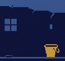
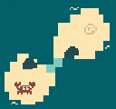
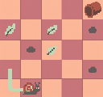

# Recursos visuais das cenas e menus

Esta pasta contém **dez miniaturas PNG ativas**, **dez ícones SVG de seleção**, a fonte local e três recursos históricos. As cenas jogáveis são desenhadas em Canvas pelo código: os PNGs não são folhas de sprites nem capturas automaticamente atualizadas do jogo.

## Miniaturas ativas

Todos os PNGs abaixo medem **128 × 120 pixels**. O ID corresponde ao catálogo. Em `app.js`, `foto(j)` usa essas imagens na seleção de dificuldade, no roteiro da Volta, na introdução da próxima parada e no resultado. O resumo da Volta também usa os PNGs. Já galeria e pausa pedem os SVGs de [icones/](icones/README.md).

| ID | Jogo | Arquivo | Cena jogável |
|---|---|---|---|
| goteira | Goteira | [goteira.png](goteira.png) | [quintal.js](../quintal.js) |
| mare | Maré Miúda | [mare.png](mare.png) | [quintal.js](../quintal.js) |
| fio | Último Fio | [fio.png](fio.png) | [quintal.js](../quintal.js) |
| pipa | Pipa de Laje | [pipa.png](pipa.png) | [quintal.js](../quintal.js) |
| radio | Rádio de Pilha | [radio.png](radio.png) | [esquina.js](../esquina.js) |
| pao | Pão na Chapa | [pao.png](pao.png) | [esquina.js](../esquina.js) |
| rastro | Rastro de Prata | [rastro.png](rastro.png) | [esquina.js](../esquina.js) |
| luz | Luz de Varanda | [luz.png](luz.png) | [varanda.js](../varanda.js) |
| gude | Três Petelecos | [gude.png](gude.png) | [varanda.js](../varanda.js) |
| pisca | Pisca no Mato | [pisca.png](pisca.png) | [varanda.js](../varanda.js) |

  

## Fonte e recursos históricos

| Arquivo | Tipo / dimensões | Estado e uso verificável |
|---|---|---|
| [miudezas.ttf](miudezas.ttf) | TrueType | Ativa: `@font-face` em [style.css](../style.css), família Miudezas. |
| [bairro.png](bairro.png) | PNG, 192 × 88 | Paisagem histórica, sem referência na abertura atual. Não substituir a capa Tijuca por ela. |
| [janela.png](janela.png) | PNG, 16 × 16 | Original arquivado; o HTML usa a cópia idêntica [janela-original.png](../artes/marca/janela-original.png). Não é o favicon atual. |
| [peteca.svg](peteca.svg) | SVG, viewBox 96 × 96 | Legado de Peteca, fora do catálogo e do aplicativo ativo. |
| [sombra.svg](sombra.svg) | SVG, viewBox 96 × 96 | Legado de Gato na Sombra, fora do catálogo e do aplicativo ativo. |

O [gerador histórico de miniaturas](../../scripts/gerar-miniaturas.mjs) lê `pracinha.js` e escreve os SVGs de seus jogos legados. Ele **não** gera os dez ícones atuais nem os dez PNGs acima. Executá-lo não reintroduz jogos na seleção; a lista ativa é definida por [catalogo.js](../catalogo.js).

## O que editar para cada necessidade

- Ícone da galeria ou pausa: [icones/](icones/README.md) e o campo `icone` do catálogo.
- Miniatura de introdução ou resultado: PNG do jogo nesta pasta.
- Personagem, folhas, água, alimento ou obstáculo dentro da partida: função `draw` do módulo correspondente.
- Capa, logotipo e favicon: [artes/](../artes/README.md).
- Paleta, enquadramento e ampliação pixelada: [style.css](../style.css), catálogo e desenho Canvas, conforme a camada.

Nenhum arquivo foi movido ou duplicado nesta organização documental. [Catálogo de design](../../docs/design/README.md) · [Manual principal](../../README.md)
