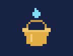
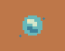

# Dez ícones da seleção e da pausa

Todos os jogos ativos possuem `icone` em [catalogo.js](../../catalogo.js). A função `foto(..., true)` em [app.js](../../app.js) usa estes SVGs na **galeria e na pausa**. Nas demais telas, continuam os [PNGs de cenas](../README.md). Os ícones não são usados para desenhar os personagens dentro das partidas.

## Inventário completo

| Jogo | Arquivo | viewBox | Referência visual registrada |
|---|---|---|---|
| Goteira | [goteira.svg](goteira.svg) | 144 × 112 | Balde com alça simples; matriz-base 24 × 24 |
| Maré Miúda | [mare.svg](mare.svg) | 72 × 56 | Caranguejo da proposta 5 |
| Último Fio | [fio.svg](fio.svg) | 72 × 56 | Bem-te-vi da proposta 5 |
| Pipa de Laje | [pipa.svg](pipa.svg) | 144 × 112 | Pipa inclinada; matriz-base 24 × 24 |
| Rádio de Pilha | [radio.svg](radio.svg) | 72 × 56 | Proposta aprovada na rodada 3 |
| Pão na Chapa | [pao.svg](pao.svg) | 144 × 112 | Versão intermediária: pão francês e ovo, matriz-base 32 × 32 |
| Rastro de Prata | [rastro.svg](rastro.svg) | 72 × 56 | Caracol da proposta 5, sem folha |
| Luz de Varanda | [luz.svg](luz.svg) | 72 × 56 | Opção A, com perna esquerda afastada |
| Três Petelecos | [gude.svg](gude.svg) | 72 × 56 | Proposta aprovada na rodada 3 |
| Pisca no Mato | [pisca.svg](pisca.svg) | 72 × 56 | Vaga-lume preservado na rodada 3 |

    

    

## Construção

Os sete SVGs com viewBox 72 × 56 enquadram a matriz de 48 × 48 com margem. Goteira e Pipa ampliam sua matriz-base por quatro; Pão amplia por três. Esses três arquivos usam viewBox 144 × 112, com região central de 96 × 96. A proporção externa é a mesma, sem confundir tamanho lógico da arte com tamanho de exibição no cartão.

Os arquivos usam retângulos contíguos e `shape-rendering="crispEdges"`, sem filtros, scripts ou fontes externas. A exibição uniforme depende também do CSS. Os desenhos da partida podem ter animações e estados que não existem no ícone estático.

## Revisão sem efeitos colaterais

Após editar um ícone aprovado, verificar galeria e pausa, incluindo telas estreitas. Conferir que introduções e resultados continuam usando os PNGs. Não alterar regras, controles, colisões ou saves para ajustar uma imagem. A suíte de navegação verifica as referências das telas; isso não substitui inspeção visual. Referências históricas de aprovação acima documentam as decisões existentes, não uma nova aprovação.

[Acervo visual](../README.md) · [Design e arte em código](../../../docs/design/README.md)
