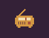
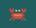
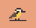
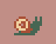
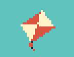
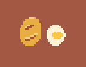

# Ícones aprovados da seleção

Estes dez desenhos aparecem na galeria e na tela de pausa. Luz de Varanda foi adicionada após aprovação específica da opção A com ajuste restrito a uma perna.

| Arquivo | Jogo | Referência |
|---|---|---|
| `radio.svg` | Rádio de Pilha | Ícone aprovado na rodada 3 |
| `gude.svg` | Três Petelecos | Ícone aprovado na rodada 3 |
| `pisca.svg` | Pisca no Mato | Vaga-lume original, preservado na rodada 3 |
| `luz.svg` | Luz de Varanda | Opção A com perna esquerda afastada; cauda, rosto e luz preservados |

   

## Construção e enquadramento

As sete primeiras artes usam matriz de 48 × 48 pixels; Goteira e Pipa usam 24 × 24, e Pão na Chapa usa 32 × 32. As três últimas usam viewBox 144 × 112 com área central de 96 × 96: ampliação inteira de 4 ou 3, mantendo a proporção de margem das anteriores. Os SVGs representam os mesmos pixels por retângulos horizontais contíguos, sem filtros, scripts, fontes ou dependências externas. `shape-rendering="crispEdges"` mantém as bordas secas. O `viewBox` 72 × 56 adiciona apenas margem de fundo em volta da matriz (12 pixels na horizontal e 4 na vertical), preservando a composição central da prévia nos cartões.

## Integração restrita

`catalogo.js` informa o caminho opcional `icone`. `app.js` pede esse asset na galeria e na pausa. As introduções, o roteiro e os resultados continuam lendo as miniaturas anteriores. Nenhuma regra, controle, recorde, conquista ou backup foi modificado. Novos ícones dependem de aprovação individual antes de alterar o catálogo.

## Verificação

O teste de navegação confere os dez cartões e a preservação das imagens fora da galeria. A rasterização local foi comparada pixel a pixel com os PNGs aprovados. Testes automatizados não substituem revisão em dispositivos físicos.

## Aprovação dos três sprites

| Arquivo | Jogo | Arte aprovada |
|---|---|---|
| `mare.svg` | Maré Miúda | Caranguejo da proposta 5 |
| `fio.svg` | Último Fio | Bem-te-vi da proposta 5 |
| `rastro.svg` | Rastro de Prata | Caracol da proposta 5, sem folha |

  

Somente a seleção muda. Folhas e sprites dentro das partidas não são alterados. Pão na Chapa usa a versão intermediária aprovada, baseada nos sprites atuais do jogo.

### Goteira, Pipa e Pão na Chapa: últimos ícones aprovados

Os dois ícones usam a grade aprovada de 24 × 24 pixels, ampliada sem suavização: balde com alça simples e pipa inclinada. São compartilhados pela seleção e pela pausa; não alteram cenas jogáveis, colisões, controles ou saves. Pão na Chapa usa a versão intermediária aprovada de 32 × 32 pixels, com pão francês e ovo baseados nos sprites reais.

  
