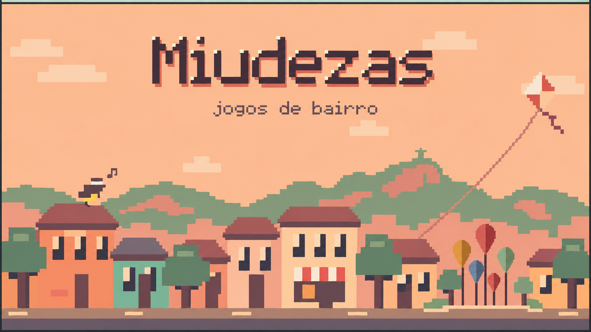

# Artes de Miudezas

## Capa oficial aprovada

[Capa e especificações](capas/README.md). Paleta quente, casas, verde das montanhas, bem-te-vi e pipa mantêm a identidade do bairro. A iluminação do título usa blocos de pixels. Cristo e Ritual do Vento aparecem como referências discretas à paisagem carioca.

## Organização

- `capas/`: composição aprovada exibida na abertura.
- [Recursos do jogo](../arte/README.md): miniaturas, ícone, fonte e cenário legado. Mantidos nos caminhos existentes para não afetar as partidas.

[Manual principal](../../README.md)
