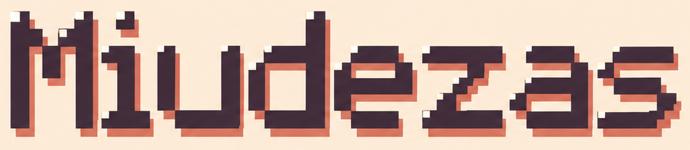

# Marca de Miudezas

## Logotipo principal

## Ícone verde

O logotipo traz letras de pixel art, sombra coral e pequenos pontos claros de iluminação. O ícone é uma janela verde com um M, preservando o mesmo desenho e acabamento.

## Arquivos e aplicação

| Arquivo | Dimensões conferidas | Referência real |
|---|---|---|
| [miudezas-logo.png](miudezas-logo.png) | 1030 × 225 | `img.brand-logo` na barra de [index.html](../../index.html). |
| [miudezas-icone-verde.png](miudezas-icone-verde.png) | 390 × 390 | `link rel="icon"` do mesmo HTML. |
| [janela-original.png](janela-original.png) | 16 × 16 | Primeira imagem da barra, distinta do favicon. |

Os dois arquivos são recortes literais da prancha, sem reconstituição, remoção de fundo ou redesenho. O fundo creme original foi mantido. As legendas e a divisória da prancha não fazem parte dos recortes. PNG garante compatibilidade com imagens em READMEs do GitHub e evita dependência de SVG com recursos externos.

## Janela original da barra

`janela-original.png`: cópia exata do ícone original de 16 × 16 pixels, com igualdade de bytes conferida nesta auditoria. Restaurado somente à esquerda do logotipo na barra superior, na composição da barra. Não substitui o favicon verde nem o logotipo principal. O arquivo original permanece em [arte/janela.png](../../arte/janela.png), sem uso direto pelo HTML atual. A cópia já existia; esta revisão documental não duplicou arquivos.

Durante uma partida, a barra conserva o nome do jogo em texto. A capa Tijuca permanece intacta.

[Artes](../README.md) · [Manual principal](../../../README.md)
