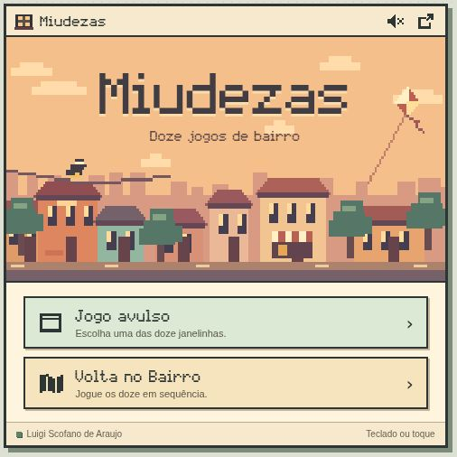

# Imagens da documentação

[inicio.jpg](inicio.jpg) é uma captura da aplicação aprovada. Mostra a capa, a assinatura do autor e as duas entradas de navegação. O cenário de telhados isolado usado pelo jogo está em [bairro.png](../dist/arte/bairro.png).

As ilustrações individuais no manual são os arquivos de galeria de [dist/arte](../dist/arte/README.md). A captura da janela registra a interface em execução, enquanto as miniaturas identificam cada parada. Se a interface mudar, a captura e o texto de navegação podem ser revisados juntos.

[Voltar ao README principal](../README.md)
