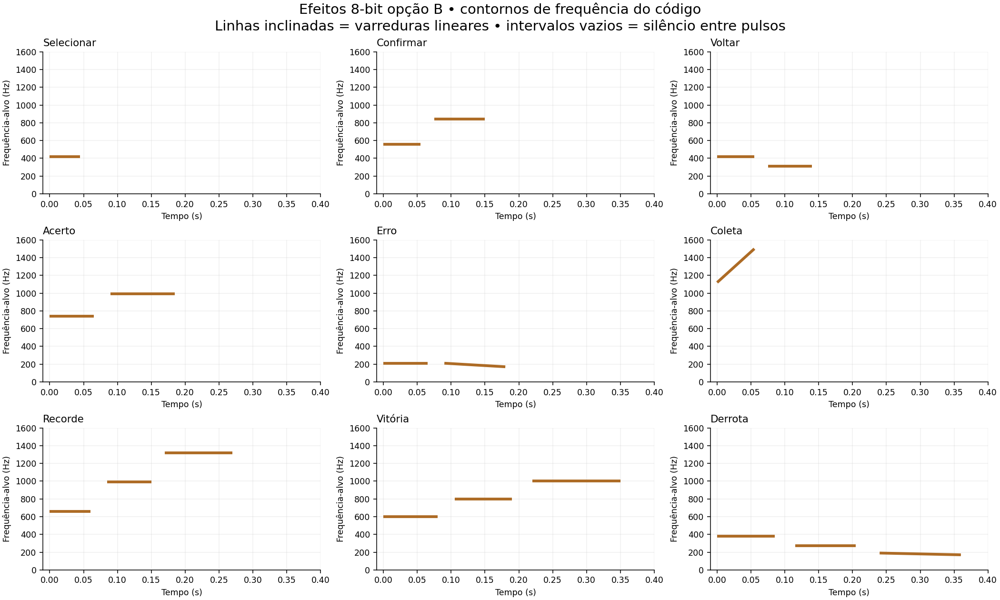

# Identidade sonora do Miudezas

A trilha combina leveza de videogame, harmonia com sétimas e nonas, síncopes brasileiras, cordas dedilhadas sintetizadas e percussão delicada inspirada em madeira, ganzá e platinelas. O objetivo é acompanhar o bairro e seus jogos sem transformar a experiência em uma sequência de alarmes.

A direção musical é **Interpretação Mais Natural**. Os efeitos pertencem à **8-bit opção B**. As imagens desta pasta documentam os arquivos dessa direção, e não as alternativas anteriores.

---

## Música por tipo de tela

| Tela | Tema | Andamento | Duração do ciclo |
|---|---|---:|---:|
| Início | Janela na Tijuca | 74 BPM | 25,95 s |
| Catálogo | Passeio no Bairro | 78 BPM | 24,62 s |
| Seleção de níveis | Uma Coisa de Cada Vez | 74 BPM | 25,95 s |
| Partida | Balanço de Quintal | 80 BPM | 24,00 s |
| Pausa | Sombra na Varanda | 66 BPM | 29,09 s |
| Roteiro da Volta no Bairro | Volta no Bairro | 78 BPM | 24,62 s |
| Próxima parada | Ali na Esquina | 76 BPM | 25,26 s |
| Resultado | Respira e Tenta | 68 BPM | 28,24 s |
| Resumo da Volta no Bairro | De Volta em Casa | 72 BPM | 26,67 s |

Cada ciclo tem oito compassos de quatro tempos. A identidade harmônica é compartilhada; andamento, interpretação, distribuição das notas e densidade diferenciam os contextos. A pausa não tem a camada de percussão dos demais temas.

### Interpretação e timbres

- O baixo usa síntese senoidal com um harmônico discreto.
- A melodia e os acordes combinam o timbre eletrônico suave com uma camada de corda amortecida por realimentação, inspirada na família Karplus–Strong.
- O gesto musical não é rigidamente quantizado: há pequenas antecipações, atrasos, mudanças de intensidade e abertura temporal entre as notas dos acordes.
- Os finais das respostas melódicas são mais curtos; os inícios de frase recebem mais presença.
- O ambiente é curto. A repetição de ataque em atraso fixo foi retirada para não criar uma resposta mecânica à melodia.

Isso é **síntese com interpretação programada**, não gravação de músicos ou instrumentos acústicos reais. Os sons foram produzidos a partir do código, sem samples externos. A textura remete a instrumentos, sem alegar uma execução acústica.

---

## Formas de onda das músicas


Os gráficos leem diretamente os WAV individuais do compositor. Mostram o envelope mínimo/máximo do **canal esquerdo**, em blocos de amostras, preservando os picos desses blocos. A escala vertical é a mesma em todos: amplitude PCM entre −1 e +1. Não há normalização individual para fazer uma faixa parecer mais forte.

Essas imagens mostram amplitude ao longo do tempo. **Não são partituras, espectrogramas ou gráficos de frequência.** O volume final percebido também depende do ganho de reprodução, do dispositivo e da mixagem do jogo. A amostra de reprodução usou ganho de apresentação adicional de aproximadamente +2 dB; os gráficos usam os masters individuais antes desse ganho.

---

## Mapa das notas


Este é um **piano roll**, uma representação temporal dos eventos definidos no compositor, não uma partitura tradicional e não uma transcrição inferida do áudio.

- Cada barra marca a altura e a duração programadas de uma nota.
- Azul: baixo. Verde: acordes. Ocre: melodia/cordas.
- A faixa inferior “Perc.” registra ataques sem nota musical definida. Eles não receberam alturas inventadas.
- O eixo horizontal usa segundos; as pequenas diferenças de início seguem os mesmos números e sementes do compositor.
- As alturas são os valores MIDI-alvo do código. Não representam uma medição da afinação física do WAV.
- A duração das barras não inclui a cauda do ambiente nem toda a propagação de ressonância.

As notas que atravessam a borda do ciclo aparecem divididas entre o fim e o começo, assim como na renderização circular do áudio.

As sementes de execução são determinísticas, permitindo reproduzir os mesmos eventos. O manifesto [eventos-sonoros.json](eventos-sonoros.json) contém **1.696 eventos das nove músicas**, além dos eventos dos efeitos, com início, duração, tipo de som, nota quando aplicável, ganho e panorama.

---

## Efeitos 8-bit opção B

Os nove efeitos de interface usam pulsos digitais curtos, suaves e discretos. Não usam cordas, acordes ou arpejos instrumentais. A música **Interpretação Mais Natural** permanece igual; somente os efeitos desta seção foram substituídos.

| Efeito | Contorno de frequência-alvo | Inícios dos pulsos |
|---|---|---|
| Selecionar | 420 Hz | 0 ms |
| Confirmar | 560 → 840 Hz | 0 e 75 ms |
| Voltar | 420 → 310 Hz | 0 e 75 ms |
| Acerto | 740 → 990 Hz | 0 e 90 ms |
| Erro | 210 Hz; depois 210 ↘ 170 Hz | 0 e 90 ms |
| Coleta | 1120 ↗ 1500 Hz | 0 ms |
| Recorde | 660 → 990 → 1320 Hz | 0, 85 e 170 ms |
| Vitória | 600 → 800 → 1000 Hz | 0, 105 e 220 ms |
| Derrota | 380 → 270 Hz; depois 190 ↘ 170 Hz | 0, 115 e 240 ms |

As setas entre pulsos indicam a sequência. ↗ e ↘ indicam uma varredura contínua dentro do pulso. Frequências são parâmetros do sintetizador, não notas temperadas de uma partitura nem medições espectrais. O som combina três componentes senoidais, fase quantizada em 32 passos, envelope de ataque/saída e filtro de suavização a 1900 Hz. Limites de pico e energia mantêm a proposta discreta. Os WAV têm 0,85 s, incluindo silêncio final; os eventos audíveis ocupam no máximo 0,36 s.


A escala dos efeitos é **−0,1 a +0,1**, a mesma entre todos eles. Não há normalização individual. Ela é mais próxima que a escala das músicas para mostrar os sinais discretos sem alterar seus valores de amplitude.



O nome histórico `notas-efeitos.png` foi mantido para preservar links, mas a figura agora é um **diagrama de frequência-alvo × tempo**, não um piano roll. As curvas seguem literalmente os eventos do código. Não incluem os harmônicos, ruído ou filtragem do espectro real. Os sinais informativos de Pisca no Mato, Rádio de Pilha e dos demais jogos continuam separados destes efeitos de interface.

---

## Reprodutibilidade das visualizações

O script [gerar_visualizacoes.py](../../scripts/audio/gerar_visualizacoes.py) precisa de Python, NumPy, SciPy e Matplotlib. Recebe dois diretórios: um com `compor.py` e os nove WAV de música; outro com os nove WAV de efeitos. O fonte `scripts/audio/efeitos_8bit.py` é lido separadamente, por padrão; use `--fonte-efeitos` para outro caminho.

```bash
python scripts/audio/gerar_visualizacoes.py \
  --musica /caminho/dos/masters-de-musica \
  --efeitos dist/audio/efeitos \
  --saida /caminho/das/visualizacoes
```

Para documentar os eventos musicais, o script executa **somente as definições e o agendamento do compositor confiável**, substituindo a síntese por registros. Não executa a etapa de renderização/exportação. Os dados de efeitos são lidos como literais da AST Python. Não use um compositor desconhecido como entrada: a parte musical executa código Python.

Para atualizar somente os efeitos preservando os dados e as imagens musicais, execute da raiz:

```bash
python scripts/audio/gerar_visualizacoes.py --somente-efeitos --saida docs/audio
```

O manifesto guarda hashes SHA-256 dos dois fontes e dos 18 WAV utilizados. Isso permite conferir de quais arquivos saíram as imagens. As figuras foram geradas e inspecionadas visualmente. Elas não comprovam, por si, ausência de falhas de reprodução no navegador ou qualidade de transição entre telas; esses aspectos precisam dos testes do sistema de áudio.

## Reprodução no jogo

[Player e limites](../../dist/audio/README.md) · [Recriar os arquivos](../../scripts/audio/README.md). As músicas de produção contêm o ganho de apresentação +2 dB e compressão FLAC sem perdas; efeitos usam os WAV 8-bit opção B. O controle de volume é independente do mute e viaja no backup versão 3, compatível com versões anteriores.
