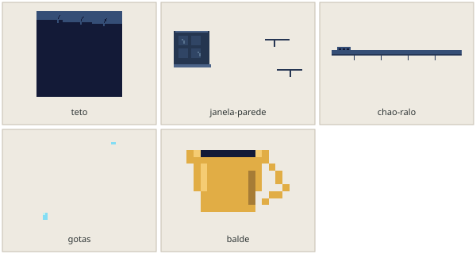
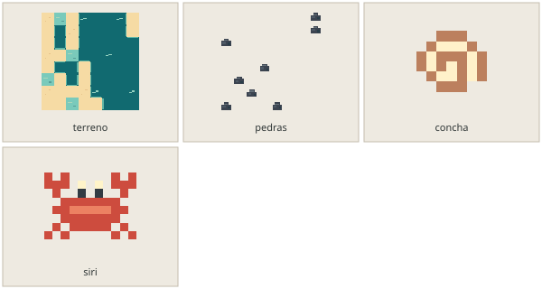
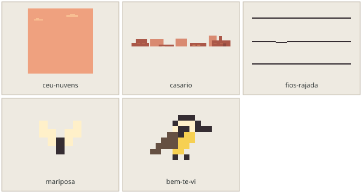
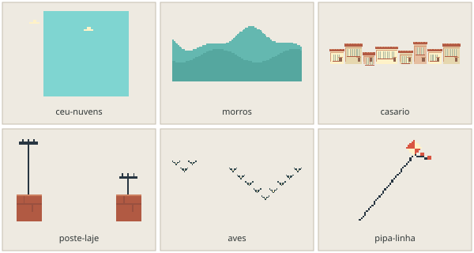
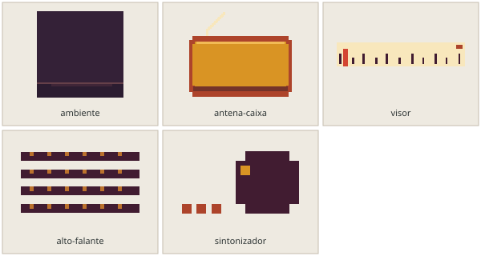
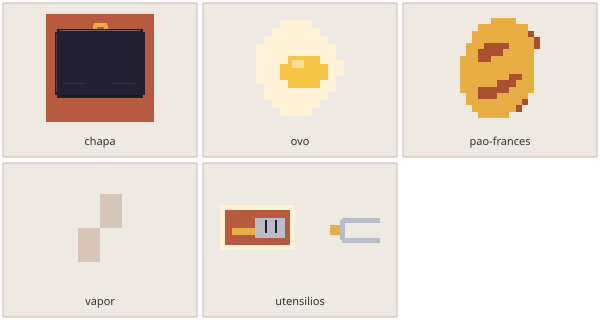
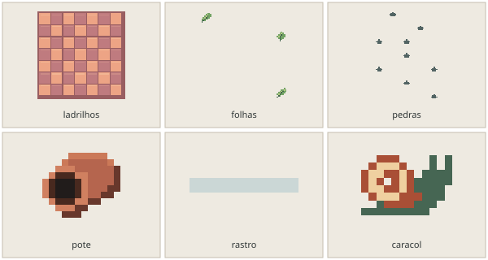
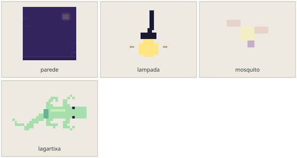
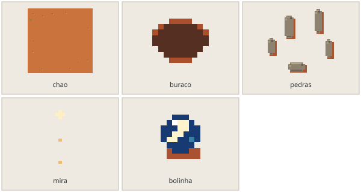
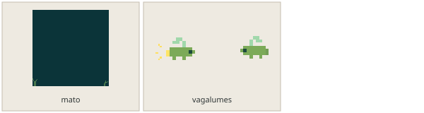

# Acervo dos elementos visuais dos jogos

Inventário dos **dez jogos ativos**, organizado em **47 famílias visuais**: personagens, objetos interativos, utensílios, destinos, obstáculos, cenários e sinais. Os arquivos são extraídos das operações reais de desenho do motor, e **não dos ícones de seleção**.

## Procedência

Base de desenho: revisão `166ca9d30a451479c7038f9dcee67992ce7fba59`, incluindo o **pote de Rastro de Prata**. Gerado em 18/11/2026.

A ferramenta instancia as fábricas de jogo, avança o relógio em passos fixos e chama `draw()`. Cada retângulo é associado ao bloco de origem usando a pilha de execução. Os marcos de código ficam em [inventario-elementos.mjs](../../scripts/inventario-elementos.mjs). Não há matrizes de sprites copiadas, redesenho, reconstrução visual manual ou alteração em `dist/`.

## O que as imagens representam

- SVGs individuais: chamadas de desenho com cores e posições relativas preservadas, fundo transparente e margem de dois pixels. Se o próprio elemento inclui um fundo (céu, parede ou piso), esse fundo continua presente.
- Pranchas: montagem documental dos mesmos grupos, com fundo neutro, legendas e escala ajustada por quadro. **Os tamanhos entre quadros não representam a escala relativa no jogo.**
- Conjuntos de pedras, folhas e aves mantêm a disposição do quadro real; não foram rearranjados como se fossem novos sprites.
- Todos os retângulos emitidos no quadro escolhido são classificados exatamente uma vez. Há estados representativos, não todos os quadros de animação ou todas as fases possíveis.
- O rastro foi desenhado com um movimento válido; a mira da bolinha usa uma tecla pressionada por 0,25 s. As demais cenas usam os instantes fixos documentados no gerador de cenas.

**Limites:** transbordamento, maré alta, flash de erro, bote, os quatro pontos dos alimentos, variações de piscada e sintonia continuam implementados no motor. Os grupos abrangem suas famílias de desenho, mas um arquivo estático não demonstra todos esses estados. O inseto de Luz de Varanda é denominado **mosquito** no código, não mosca. O destino de Maré Miúda é uma concha; o de Rastro é um pote/vaso; o de Três Petelecos é o buraco.

---

## Galeria por jogo

### Goteira

[Inventário e arquivos individuais](goteira/README.md) · [Desenho de origem](../../dist/quintal.js)

Teto e rachaduras; Janela e marcas da parede; Piso, ralo e água no chão; Gotas e respingos; Balde, alça e conteúdo.



---

### Maré Miúda

[Inventário e arquivos individuais](mare/README.md) · [Desenho de origem](../../dist/quintal.js)

Mar, areia, espuma, ondulações e travessias; Pedras e sombras; Concha de destino; Siri / caranguejo.



---

### Último Fio

[Inventário e arquivos individuais](fio/README.md) · [Desenho de origem](../../dist/quintal.js)

Céu e nuvens; Casas, telhados e chaminé; Fios e sinal de rajada; Mariposa; Bem-te-vi.



---

### Pipa de Laje

[Inventário e arquivos individuais](pipa/README.md) · [Desenho de origem](../../dist/quintal.js)

Céu e nuvens; Duas camadas de morros; Fachadas, janelas, portas e telhados; Postes e lajes; Bando de aves em V; Pipa, linha, rabiola e laços.



---

### Rádio de Pilha

[Inventário e arquivos individuais](radio/README.md) · [Desenho de origem](../../dist/esquina.js)

Parede e bancada; Antena, caixa e acabamento; Escala, ponteiro e luz de sintonia; Grade do alto-falante; Botão e marcadores das estações.



---

### Pão na Chapa

[Inventário e arquivos individuais](pao/README.md) · [Desenho de origem](../../dist/esquina.js)

Chapa, alça, bordas e fundo; Ovo: clara, gema e brilho; Pão francês e cortes da casca; Vapor dos alimentos; Espátula, pinça e seleção.



---

### Rastro de Prata

[Inventário e arquivos individuais](rastro/README.md) · [Desenho de origem](../../dist/esquina.js)

Ladrilhos e acabamento; Três folhas com desenhos diferentes; Pedras; Pote de destino; Rastro construído; Caracol e concha.



---

### Luz de Varanda

[Inventário e arquivos individuais](luz/README.md) · [Desenho de origem](../../dist/varanda.js)

Parede, relevo e rodapé; Lâmpada, fio e sinais de luz; Mosquito e asas; Lagartixa: corpo, membros, cauda e olhos.



---

### Três Petelecos

[Inventário e arquivos individuais](gude/README.md) · [Desenho de origem](../../dist/varanda.js)

Terra batida, grãos e vegetação; Buraco de destino; Pedras e sombras; Mira e indicação de alcance; Bolinha de gude, brilho e sombra.



---

### Pisca no Mato

[Inventário e arquivos individuais](pisca/README.md) · [Desenho de origem](../../dist/varanda.js)

Fundo noturno e vegetação; Vagalumes, asas, abdômen e sinais de luz.



---

## Reprodução e verificação

```sh
node scripts/gerar-elementos-visuais.mjs
node --test tests/elementos-visuais.test.mjs
```

Sem dependências externas. Requer Node moderno, como a configuração de testes do projeto. O script não é carregado pelo site e não aumenta seu trabalho por quadro. Depois de mudar `draw()`, regenere, confira as pranchas visualmente e ajuste os marcos caso um bloco tenha mudado de lugar. Os testes conferem determinismo, cobertura das operações, arquivos versionados e pranchas.

[Inventário legível por máquina](inventario.json) · [README principal](../../README.md#elementos-visuais-dentro-dos-jogos)
