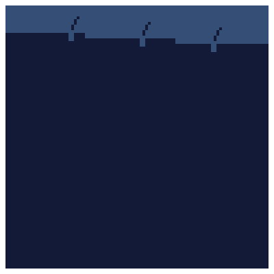
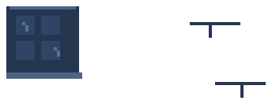
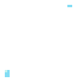
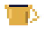

# Elementos de Goteira

[Índice do acervo](../README.md) · [Código de desenho](../../../dist/quintal.js)

Extração dos blocos reais de `draw()`, nível Puxado, semente `20261118`. Elementos agrupados por função, não ícones da seleção. As coordenadas relativas são preservadas; por isso conjuntos como folhas e pedras mantêm o espaçamento do tabuleiro. Fundo transparente.

## Teto e rachaduras

## Janela e marcas da parede

## Piso, ralo e água no chão

## Gotas e respingos

## Balde, alça e conteúdo

