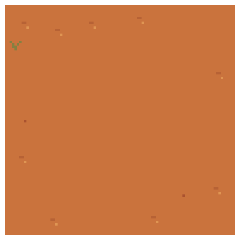
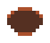
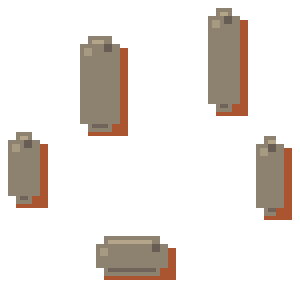

# Elementos de Três Petelecos

[Índice do acervo](../README.md) · [Código de desenho](../../../dist/varanda.js)

Extração dos blocos reais de `draw()`, nível Puxado, semente `20261118`. Elementos agrupados por função, não ícones da seleção. As coordenadas relativas são preservadas; por isso conjuntos como folhas e pedras mantêm o espaçamento do tabuleiro. Fundo transparente.

## Terra batida, grãos e vegetação

## Buraco de destino

## Pedras e sombras

## Mira e indicação de alcance

## Bolinha de gude, brilho e sombra

