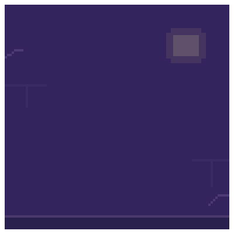
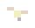
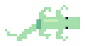

# Elementos de Luz de Varanda

[Índice do acervo](../README.md) · [Código de desenho](../../../dist/varanda.js)

Extração dos blocos reais de `draw()`, nível Puxado, semente `20261118`. Elementos agrupados por função, não ícones da seleção. As coordenadas relativas são preservadas; por isso conjuntos como folhas e pedras mantêm o espaçamento do tabuleiro. Fundo transparente.

## Parede, relevo e rodapé

## Lâmpada, fio e sinais de luz

## Mosquito e asas

## Lagartixa: corpo, membros, cauda e olhos

