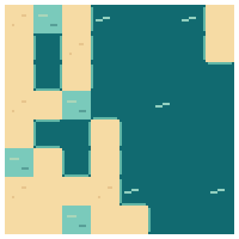
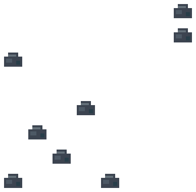
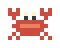

# Elementos de Maré Miúda

[Índice do acervo](../README.md) · [Código de desenho](../../../dist/quintal.js)

Extração dos blocos reais de `draw()`, nível Puxado, semente `20261118`. Elementos agrupados por função, não ícones da seleção. As coordenadas relativas são preservadas; por isso conjuntos como folhas e pedras mantêm o espaçamento do tabuleiro. Fundo transparente.

## Mar, areia, espuma, ondulações e travessias

## Pedras e sombras

## Concha de destino

## Siri / caranguejo

