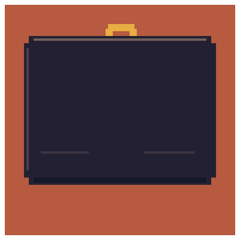
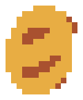

# Elementos de Pão na Chapa

[Índice do acervo](../README.md) · [Código de desenho](../../../dist/esquina.js)

Extração dos blocos reais de `draw()`, nível Puxado, semente `20261118`. Elementos agrupados por função, não ícones da seleção. As coordenadas relativas são preservadas; por isso conjuntos como folhas e pedras mantêm o espaçamento do tabuleiro. Fundo transparente.

## Chapa, alça, bordas e fundo

## Ovo: clara, gema e brilho

## Pão francês e cortes da casca

## Vapor dos alimentos

## Espátula, pinça e seleção

