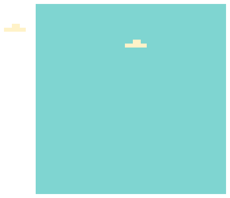
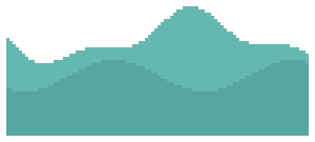
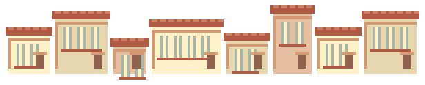
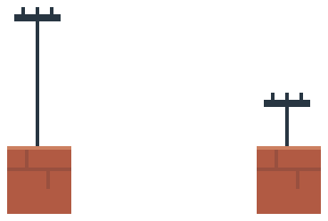
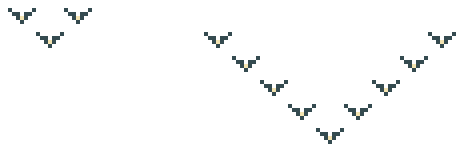
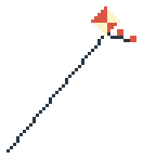

# Elementos de Pipa de Laje

[Índice do acervo](../README.md) · [Código de desenho](../../../dist/quintal.js)

Extração dos blocos reais de `draw()`, nível Puxado, semente `20261118`. Elementos agrupados por função, não ícones da seleção. As coordenadas relativas são preservadas; por isso conjuntos como folhas e pedras mantêm o espaçamento do tabuleiro. Fundo transparente.

## Céu e nuvens

## Duas camadas de morros

## Fachadas, janelas, portas e telhados

## Postes e lajes

## Bando de aves em V

## Pipa, linha, rabiola e laços

