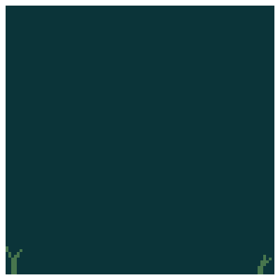
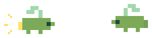

# Elementos de Pisca no Mato

[Índice do acervo](../README.md) · [Código de desenho](../../../dist/varanda.js)

Extração dos blocos reais de `draw()`, nível Puxado, semente `20261118`. Elementos agrupados por função, não ícones da seleção. As coordenadas relativas são preservadas; por isso conjuntos como folhas e pedras mantêm o espaçamento do tabuleiro. Fundo transparente.

## Fundo noturno e vegetação

## Vagalumes, asas, abdômen e sinais de luz

