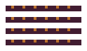

# Elementos de Rádio de Pilha

[Índice do acervo](../README.md) · [Código de desenho](../../../dist/esquina.js)

Extração dos blocos reais de `draw()`, nível Puxado, semente `20261118`. Elementos agrupados por função, não ícones da seleção. As coordenadas relativas são preservadas; por isso conjuntos como folhas e pedras mantêm o espaçamento do tabuleiro. Fundo transparente.

## Parede e bancada

## Antena, caixa e acabamento

## Escala, ponteiro e luz de sintonia

## Grade do alto-falante

## Botão e marcadores das estações

