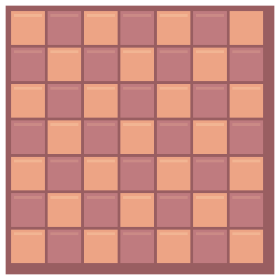
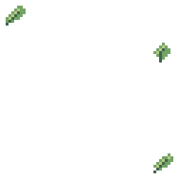
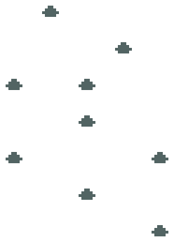
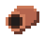
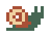

# Elementos de Rastro de Prata

[Índice do acervo](../README.md) · [Código de desenho](../../../dist/esquina.js)

Extração dos blocos reais de `draw()`, nível Puxado, semente `20261118`. Elementos agrupados por função, não ícones da seleção. As coordenadas relativas são preservadas; por isso conjuntos como folhas e pedras mantêm o espaçamento do tabuleiro. Fundo transparente.

## Ladrilhos e acabamento

## Três folhas com desenhos diferentes

## Pedras

## Pote de destino

## Rastro construído

## Caracol e concha

