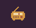
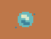
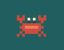
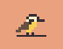
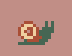
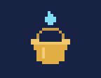
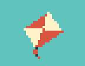
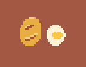

# Evolução visual e decisões aprovadas

Registro histórico das revisões visuais do projeto. Para o estado atual e o inventário, consulte o [manual principal](../README.md) e o [guia de design](design/README.md). As expressões “não altera” abaixo descrevem o escopo de cada revisão, não afirmam que o projeto nunca evoluiu.

## Artes do jogo e capa aprovada

A [pasta de artes](../dist/artes/README.md) reúne a documentação da nova capa e aponta para os demais recursos visuais. A [capa Tijuca](../dist/artes/capas/miudezas-tijuca.png) é o arquivo aprovado, preservado sem recortes: título com iluminação em blocos de pixels, bem-te-vi com nota musical, pipa sobre os telhados e referência escultórica ao Ritual do Vento. A referência é uma interpretação artística, não uma reprodução documental do monumento. As janelas sobrepostas às portas das casas verde, laranja e amarela foram removidas da capa, mantendo as portas e as demais janelas. A revisão não altera jogos, layout, controles ou progresso.

A aplicação exibe a composição inteira com `object-fit: contain`, sem esticar a imagem nem sobrepor outro título. O título textual continua disponível para tecnologias assistivas. A alteração não modifica catálogo, regras, controles ou progresso salvo. A antiga paisagem `dist/arte/bairro.png` permanece apenas como recurso legado, sem uso na abertura.

### Logotipo e ícone

A [documentação da marca](../dist/artes/marca/README.md) apresenta o logotipo principal, a janela verde e suas aplicações. Os PNGs são recortes fiéis da prancha aprovada, não redesenhos. A marca aparece na barra dos menus e o nome do jogo continua visível durante cada partida.

### Janela original da interface

A janela original permanece ao lado da marca na barra superior. O ícone verde aprovado continua sendo o favicon. Veja [arquivos e aplicações](../dist/artes/marca/README.md).

## Catálogo atual e compatibilidade

Peteca e Gato na Sombra foram retirados. Os dez jogos ativos, na ordem da Volta no Bairro, são Goteira, Maré Miúda, Último Fio, Pipa de Laje, Rádio de Pilha, Pão na Chapa, Rastro de Prata, Luz de Varanda, Três Petelecos e Pisca no Mato. IDs históricos continuam reconhecidos pela migração de saves; vitórias não são transferidas para outro jogo. Links numéricos dos jogos removidos retornam à galeria. Código/arte legados não são importados pelo aplicativo.

### Refinamento visual: quintal

Goteira, Último Fio e Pipa de Laje: detalhes discretos no cenário, sem alterar a jogabilidade. A arte aprovada de Maré já estava incorporada. Consulte o [guia visual e técnico](jogos/quintal/README.md#acabamento-visual-aprovado).

### Refinamento visual: esquina

Rádio de Pilha e Pão na Chapa: acabamento discreto em pixels, preservando todos os controles e objetivos. Consulte o [guia visual e técnico](jogos/esquina/README.md#acabamento-visual-aprovado).

### Refinamento visual: varanda

Luz de Varanda e Três Petelecos: luz, texturas e sprites refinados sem mudar obstáculos ou física. Consulte o [guia visual e técnico](jogos/varanda/README.md#acabamento-visual-aprovado).

### Visual de Pisca e Rastro

Pisca no Mato mantém o primeiro visual dos vaga-lumes preservado no GitHub (`9cc7bbb`) e da vegetação lateral, restaurado a pedido do autor. Sem Parar, recordes e sequência continuam inalterados. Rastro de Prata apresenta três folhas finas com silhuetas distintas, na mesma paleta e escala. São mudanças de desenho: regras, controles, mapas e saves permanecem iguais.

### Segundo refinamento aprovado: Maré e Rastro

Maré Miúda recebeu espuma costeira, areia discreta, baixios destacados, pedras facetadas e concha preenchida. Rastro de Prata recebeu apenas brilho nas bordas dos ladrilhos, preservando as folhas finas B. Este lote não modifica os outros oito jogos, incluindo o visual restaurado de Pisca.

## Ícones aprovados na seleção

Os dez jogos usam seus ícones em pixel art nos cartões de **Escolha um jogo**. Todos os dez jogos agora possuem ícone aprovado. A mudança é só de apresentação: introduções, resultados, partidas, controles e dados salvos continuam iguais.

| Rádio de Pilha | Três Petelecos | Pisca no Mato |
|---|---|---|
|  |  |  |

[Arquivos, proporções e manutenção dos ícones](../dist/arte/icones/README.md).

### Destino mais visível em Rastro de Prata

O vaso foi ampliado de 8 × 7 para 11 × 10 pixels, conservando a paleta e o estilo do desenho. Ele permanece dentro de uma única casa, inclusive nos tabuleiros de 7 × 7, sem alterar destino, colisões, caminhos ou progresso.

### Luz de Varanda: opção A aprovada

O cartão usa a opção A com apenas a perna esquerda afastada do corpo, conforme aprovação. Cauda, rosto com piscadinha e luz foram preservados. É uma imagem estática; não foi introduzida nova animação. A lagartixa e a iluminação dentro da partida não mudam.

### Pão francês aprovado

Pão na Chapa usa a versão aprovada baseada na referência enviada: pão francês alongado, com dois cortes diagonais e cores chapadas. O sprite tem 13 × 16 pixels, desenhado em escala 2 na chapa. As quatro paletas mostram antes do ponto, no ponto, tostado e queimado, preservando a fumaça. Ovo, utensílios, áreas de toque, tempos, metas, reposições e alternância de lados não mudam. Os testes de identidade verificam o novo desenho em ambos os lados; a suíte mantém os testes dos três níveis, vitória, queima e três erros.

### Ícones de Maré Miúda, Último Fio e Rastro de Prata

  

Os três ícones aprovados usam os sprites dos respectivos jogos como referência. O caracol não inclui folha no ícone; as folhas coletáveis dentro da partida permanecem intactas. O conjunto completo dos dez ícones está aprovado.

### Tela de pausa coesa

A pausa usa a mesma imagem da seleção: ícone aprovado quando disponível e miniatura original nos demais jogos. A imagem é contida sem recorte. “Continuar” e “Voltar às fases” permanecem na primeira linha; “Voltar ao menu” ocupa a segunda linha, centralizado e com a mesma largura dos demais botões. O ajuste é exclusivo da pausa e mantém navegação, progresso e controles. O teste de navegação verifica a arte e as três ações dos dez jogos.

### Goteira, Pipa e Pão na Chapa: últimos ícones aprovados

Os ícones de Goteira e Pipa usam a grade aprovada de 24 × 24 pixels, ampliada sem suavização: balde com alça simples e pipa inclinada. São compartilhados pela seleção e pela pausa; não alteram cenas jogáveis, colisões, controles ou saves. Pão na Chapa usa a versão intermediária aprovada de 32 × 32 pixels, com pão francês e ovo baseados nos sprites reais.

  

### Porta da lojinha na capa

A entrada sob o toldo listrado usa verde discreto e maçaneta clara para se distinguir da fachada escura e da vitrine âmbar. A porta chega à calçada, sem parecer uma extensão solta da fachada. A revisão é apenas na imagem: proporção, controles, regras e dados dos jogos permanecem inalterados.

### Pipa de Laje: passarinhos em V

O obstáculo aéreo usa a formação aprovada: uma ponta inferior e pares de aves subindo pelos dois lados, com quantidade proporcional à altura. A colisão segue os pixels das aves, não preenche os espaços vazios do V. Postes, cenário, controles, dificuldade e progresso são preservados. [Regras, implementação e testes](jogos/quintal/README.md#pipa-bando-em-v-aprovado).
