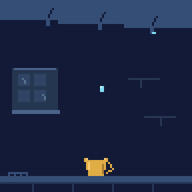
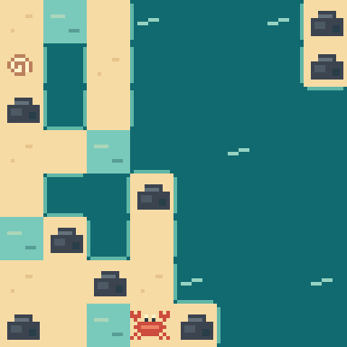
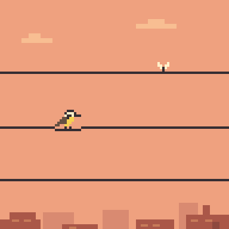
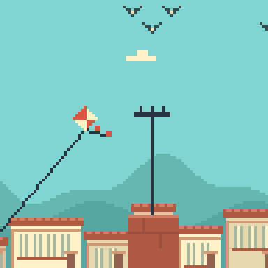
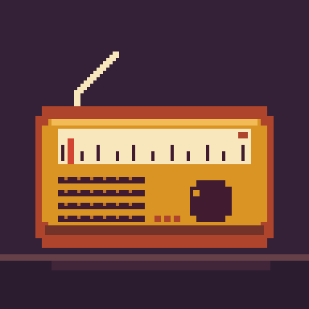
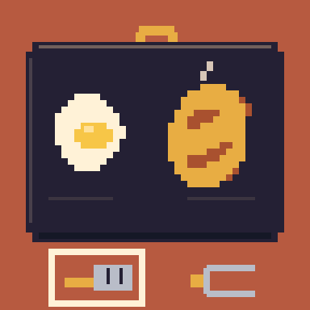
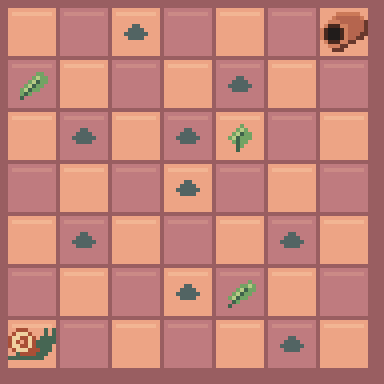
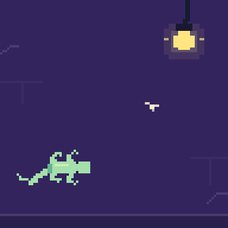
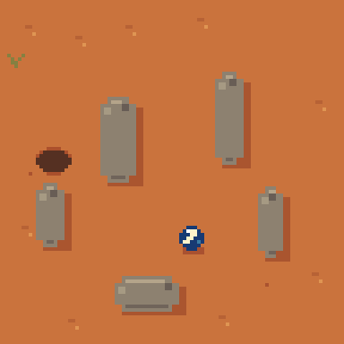
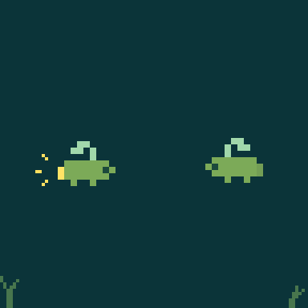

# Cenas atuais dos jogos

Estas imagens acompanham as dez fichas de **Jogos e level design** no README principal. Complementam, sem apagar, os ícones aprovados e as miniaturas armazenadas.

## Origem e fidelidade

Geradas em 18/11/2026 a partir do código da revisão `909e1eb3f40115e24fd2415e75ef38ef30a2ee78`. Cada imagem chama a fábrica real do jogo no nível **Puxado** e seu método `draw()`, em uma grade de 96 × 96. O SVG registra os mesmos retângulos e transformações do Canvas. A ampliação mantém pixels nítidos e não contém cursor.

Não são mockups, sprites alternativos nem capturas da janela inteira do navegador. São quadros reais do tabuleiro renderizados pelo motor: não incluem os controles e indicadores externos ao Canvas. O navegador local não iniciou no ambiente de produção destas imagens; por isso não são descritas como screenshots.

## Reprodução

```sh
node scripts/gerar-cenas-atuais.mjs
node --test tests/cenas-documentacao.test.mjs
```

Não há dependências externas. O script usa a semente `20261118` e passos de 1/60 s, com instantes fixos por jogo. Fases de percurso são mostradas no início; jogos animados avançam brevemente para mostrar seus elementos. A renderização falha se o quadro escolhido já estiver em uma partida encerrada.

Reexecute após alterar a arte ou o level design e confira visualmente os dez arquivos. Os testes garantem que os SVGs versionados correspondem ao desenho atual. As imagens ficam apenas na documentação; o script não altera `dist/`, regras, saves ou backups.

## Galeria

### goteira



### mare



### fio



### pipa



### radio



### pao



### rastro

Cena atualizada com o pote aprovado em 18/11/2026: boca circular, sombras escuras e retirada somente da faixa clara atrás do destino. Renderizada pelo mesmo método descrito acima, após essa alteração visual.



### luz



### gude



### pisca



[Voltar ao README principal](../../../README.md#jogos-e-level-design)
